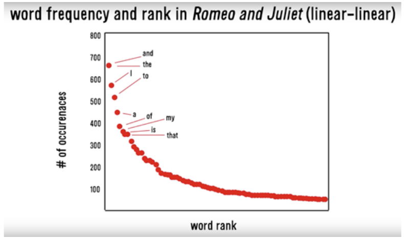
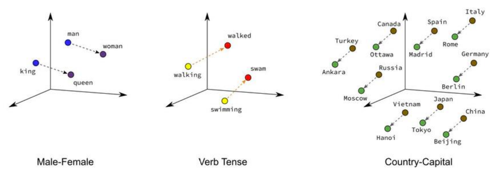
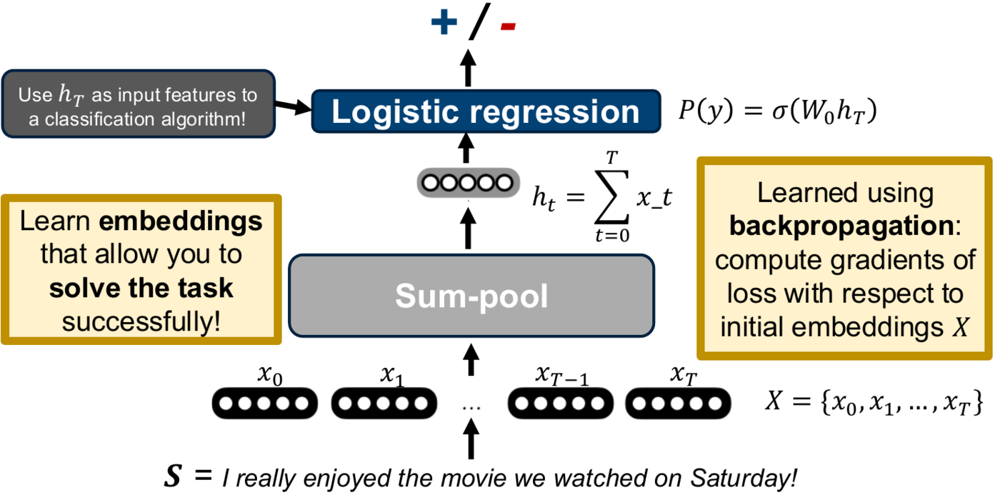
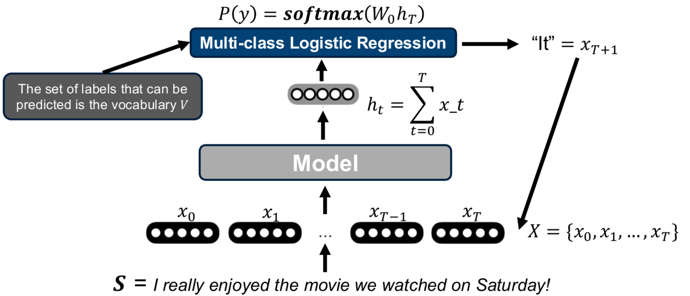

# Lecture 1 — Introduction to NLP

> This lecture shows how to turn raw text into something a machine learning model can use. It covers the classical route (bag of words, TF-IDF and the preprocessing "tricks") and then sets up the modern neural view of NLP: embeddings, a model, and a prediction.

**After this lecture you should be able to:**
- Frame document retrieval, document classification, sentiment analysis and topic detection as ML problems.
- Build a bag-of-words vector and explain why bag-of-words matrices are huge and sparse (including Zipf's law).
- Explain the main preprocessing steps (tokenization, stopword removal, casefolding, stemming, lemmatization) and their trade-offs.
- Compute IDF and TF-IDF, and compare L1 vs L2 row normalization.
- Contrast sparse count vectors with dense word embeddings.
- Describe the three parts of a neural NLP system and apply them to classification, sequence labeling and text generation.

---

## 1. What is NLP?

**Natural language processing (NLP)** is the processing of natural language by a computer, a subfield of computer science tied to AI and linguistics. It serves three broad goals:

| Goal | Example applications |
|---|---|
| Enabling human–machine collaboration | Search engines, dialogue agents, text generation |
| Accelerating human–human communication | Machine translation, text summarization, information extraction |
| Mining human insights | Sentiment analysis, motivation analysis, emotion detection |

Much of today's data is **unstructured text**: the Web, social media, news, search queries.

## 2. Four typical tasks on text

| Task | Given | Goal | ML framing |
|---|---|---|---|
| **Document retrieval** | A corpus and a query (document or short string) | Rank all documents by similarity to the query | Nearest-neighbour search (as in kNN) |
| **Document classification** | A document $`d`$ and a set of classes (e.g., news, sports, tech) | Decide which class $`d`$ belongs to | Supervised classification |
| **Sentiment analysis** | A document $`d`$ (e.g., a product review) | A score for how positive/negative $`d`$ is | Supervised regression or classification |
| **Topic detection** | An *unlabeled* collection | Find prevalent topics, and which topics each document belongs to | Clustering (or matrix factorization) |

- **Retrieval:** define a distance between documents; for a query $`q`$, return the $`k`$ documents with the smallest distance. The hard part is crafting or learning a good distance function and scaling it to the Web.
- **Classification and sentiment:** label a training set, then train any supervised model (kNN, logistic regression, random forests, ...).
- **Topic detection:** run hierarchical (agglomerative/divisive) or point-assignment (k-means, DBSCAN) clustering.

Notice the common step: **every task needs documents as feature vectors.**

## 3. Feature vectors and bag of words

Nearly all ML methods expect fixed-length **feature vectors**. Text is not one:
- documents have variable length;
- even with fixed length (e.g., a tweet), position $`i`$ doesn't mean the same thing in every document.

So you need a map from an arbitrary string to a fixed-length vector. The traditional answer is **bag of words**. The modern answer is to *learn* the mapping (a **text embedding**).

A **bag** is a multiset: it keeps how often each word occurs ("multi") but drops word order ("set").

> "what you see is what you get" → {get:1, is:1, see:1, what:2, you:2}

To get a fixed length, use one vector entry per word in the vocabulary. The result is very **high-dimensional** (typically $`10^5`$–$`10^6`$) and very **sparse**: `[0…0 1 0…0 1 0…0 1 0…0 2 0…0 2 0…0]`.

### Zipf's law

Sparsity is made worse by **Zipf's law**: the probability of a word falls off inversely with its frequency rank,

```math
p(w_i) \propto \frac{1}{i}
```

where $`w_i`$ is the $`i`$-th most frequent word. A few words (*the*, *and*, *to*) are extremely common; most words are rare, so most entries in any document's vector are zero.

<p align="center">
  
</p>
<p align="center"><em>Zipf's law in Romeo and Juliet: a handful of function words dominate, and the long tail of rare words is what makes BoW vectors so sparse.</em></p>

### The bag-of-words matrix

Stack document vectors as rows: **one row per document, one column per vocabulary word**. For Wikipedia, 6M docs × 2M words gives 12 trillion entries. The fix is a **sparse matrix format** that stores only non-zero triples `(doc_idx, word_idx, count)`. Assuming about 2,000 words per article, that is about 12 billion non-zeros, which fits in memory. With this matrix you can, in theory, use any ML model.

## 4. Bag of tricks: from raw text to a good matrix

In practice it is "garbage in, garbage out". How you map raw text to the matrix matters a lot.

- **Character encoding.** Characters map to bytes (old: ASCII, Latin-1; new: Unicode such as UTF-8/16/32). Read a file with the encoding it was written in; this matters most for non-English text.
- **Language identification.** You usually want one language, but content is increasingly multilingual. Use the language code if given; otherwise use a library, typically based on **letter trigrams** ("eau", "sch", "ção").
- **Tokenization.** Split a string into **tokens** (≈ words): "Hello! How are you?" → `Hello _ ! _ How _ are _ you _ ?`. Splitting on whitespace and punctuation breaks on cases like "Mr." or ":-)". Use a library (spaCy, nltk, Stanford CoreNLP). It is hard in Chinese (no spaces) and for compounds (German "Donaudampfschifffahrtskapitän").
- **Stopword removal.** Very frequent "small" words (*a, the, is, you, I*, punctuation) carry little information and can drown out content words. A useful heuristic is to drop words that appear in at least $`p\%`$ of documents. But be careful: for author identification or psychological modelling, stopwords and punctuation ("!!!", ":-)") can be the signal. *Don't throw out the baby with the bathwater.*
- **Casefolding.** Lower-casing merges "yams"/"Yams", but also merges "apple"/"Apple". With large datasets it is usually best *not* to casefold. With small datasets it can help by reducing sparsity.
- **Stemming.** Strip affixes heuristically (e.g., Porter stemmer): "walking", "walks", "walked" → "walk". *Pro:* less sparsity. *Con:* loses information ("business", "busy" → "busi"). It is rarely used for English with big data, but still useful for morphologically rich languages (German, Finnish).
- **Lemmatization** ("stemming++"). Map tokens to lexicon entries: "U.S.A.", "US" → "United States"; it must tell "lie (in the grass)" from "lie (to me)". It needs a full lexicon and complex rules, so it is often skipped, especially for non-English text.
- **Social-media text.** "ikr smh he asked fir yo last name so he can add u on fb lololol" (slang, abbreviations, misspellings) breaks standard tools; use dedicated toolkits (e.g., TweetNLP).

### Tokens vs n-grams

So far the columns were single tokens (**unigrams**). But some sequences belong together: "United States", "operating system". You can add **n-grams** (bigrams, trigrams, ...). Using all 5-grams can even beat neural networks on some tasks. The catch is a **combinatorial explosion** in the number of columns.

## 5. Postprocessing the matrix: TF-IDF and normalization

### IDF

Not all words are equally informative ("per" vs "perceptron"). Beyond removing stopwords, you want to down-weight common words. With $`N`$ documents and $`\text{docfreq}(w)`$ = number of documents containing $`w`$:

```math
\text{idf}(w) = -\log\frac{\text{docfreq}(w)}{N} = \log N - \log \text{docfreq}(w)
```

A word that appears in every document gets $`\text{idf} = 0`$. A rare word gets a large weight.

### TF-IDF

The **term frequency** $`\text{tf}(d, w)`$ is just the bag-of-words count (e.g., $`\text{tf}(d, \text{what}) = 2`$ above). The **TF-IDF** entry for document $`d`$ and word $`w`$ is

```math
\text{tf}(d, w) \cdot \text{idf}(w)
```

This is the same as multiplying each column $`w`$ by the constant $`\text{idf}(w)`$, with idf computed on the whole corpus.

### Row normalization

Longer documents have more non-zeros, so they have longer vectors and sit far from short ones. That can throw off ML algorithms. Fix: normalize each **row** (document vector).

| | L2 normalization | L1 normalization |
|---|---|---|
| Rule | Divide row by its Euclidean norm | Divide row by the sum of its entries |
| Result | Every row has length 1 (points on the unit sphere) | Every row sums to 1 (a probability distribution) |

Which is better depends on the task: try both.

### Column normalization

IDF scaling is itself a form of **column normalization**. You can additionally **min-max scale** columns or **standardize** them (subtract the mean, divide by the standard deviation). Again, whether any of these helps is an empirical question.

**Classical NLP in one line:** for all four tasks, the TF-IDF matrix (entry $`\text{tf}(d,w)\cdot\text{idf}(w)`$) is a strong starting representation.

## 6. Modern (neural) NLP

A neural NLP system has **three parts**:
1. **Embeddings:** how do we represent sequences of discrete words?
2. **Model:** how do we compose embeddings into higher-level (sequence-level) representations?
3. **Prediction:** how do we map the model's representation to a task prediction?

### Sparse vs dense vectors

Historically, a sentence like "I really enjoyed the movie!" became a sparse vector: simple counts, or counts weighted by corpus statistics (TF-IDF). The problem: **with sparse vectors, similarity depends only on shared words.** "enjoyed" and "loved" are different columns, so $`\text{sim}(\textit{enjoyed}, \textit{loved}) = 0`$.

In neural NLP, **words are vectors**. Each word gets a **dense, real-valued** vector (also called word vectors, word embeddings, neural embeddings). Its dimensionality is much smaller than a sparse vector but still around $`O(10^3)`$. **Similarity of vectors represents similarity of meaning**: ideally the space captures relations like male–female (*king*/*queen*), verb tense (*walking*/*walked*) and country–capital. How to train such "semantic" embeddings is the topic of the next lecture.

<p align="center">
  
</p>
<p align="center"><em>The goal of dense embeddings: relations like gender, tense and country–capital become consistent directions in the vector space.</em></p>

### Running example: sentiment analysis

Sentence $`S`$ = "I really enjoyed the movie we watched on Saturday!", label: + or −.

**Embeddings.** $`S`$ becomes a sequence of embeddings $`X = \{x_0, x_1, \dots, x_T\}`$. Each $`x_t`$ is looked up in a shared **embedding dictionary** $`E`$ that has one entry per word in the vocabulary $`V`$. So "we" in $`S_2`$ = "we really loved a film we saw last Sunday!" uses the *same* embedding as "we" in $`S`$.

**Model.** Compose the embeddings into one representation. The simplest choice is **sum-pooling**:

```math
h_T = \sum_{t=0}^{T} x_t
```

(The model's output is usually written $`h`$ or $`o`$.) Better models come later: RNNs and variants (LSTM, GRU), and self-attention / Transformers.

**Prediction.** Use $`h_T`$ as input features to **logistic regression**:

```math
P(y) = \sigma(W_0 h_T)
```

Everything is trained with **backpropagation**: compute gradients of the loss with respect to $`W_0`$ *and* the embeddings, so you learn embeddings that help solve the task.

<p align="center">
  
</p>
<p align="center"><em>The full sentiment system: embeddings → sum-pool → logistic regression, with gradients flowing all the way back into the embeddings.</em></p>

### Beyond classification

- **Sequence labeling:** predict a label for *every* token, e.g., which words are sentimental. A model (RNN, self-attention, Transformer) produces one output $`h_t`$ per position, and each $`h_t`$ gets its own +/− prediction.
- **Text generation, word-by-word:** to continue the review, use **multi-class logistic regression** whose labels are the whole vocabulary $`V`$:

```math
P(y) = \text{softmax}(W_0 h_T)
```

Predict the next word (e.g., "It" $`= x_{T+1}`$), append its embedding to $`X`$, recompute $`h_{T+1}`$, predict the next word ("was" $`= x_{T+2}`$), and so on.

<p align="center">
  
</p>
<p align="center"><em>Generation is classification over the whole vocabulary, with each predicted word fed back into the input sequence.</em></p>

---

## Key takeaways
- The four classic text tasks (retrieval, classification, sentiment, topics) all need documents as fixed-length feature vectors.
- Bag of words keeps word counts, drops order, and gives huge, sparse vectors; Zipf's law makes them sparser.
- Preprocessing choices (tokenization, stopwords, casefolding, stemming, lemmatization) are trade-offs that depend on your task and data size.
- TF-IDF = term count × $`\log(N/\text{docfreq})`$; it down-weights words that appear everywhere.
- Row normalization (L1 or L2) removes document-length effects; column normalization rescales features.
- Neural NLP = embeddings + model + prediction; dense embeddings let similar words have similar vectors.
- The same setup handles classification (sigmoid), sequence labeling (one output per token) and generation (softmax over $`V`$).

## Check yourself
<details>
<summary>What is the bag of words for "what you see is what you get"?</summary>

{get:1, is:1, see:1, what:2, you:2}. Counts are kept, order is lost.
</details>

<details>
<summary>Why is the bag-of-words matrix stored as triples rather than a full matrix?</summary>

It is enormous (Wikipedia: 6M × 2M = 12 trillion entries) but almost all entries are zero. Storing only non-zero (doc_idx, word_idx, count) triples gives about 12 billion entries, which fits in memory.
</details>

<details>
<summary>A word appears in every document of the corpus. What is its IDF, and what happens to its TF-IDF column?</summary>

$`\text{idf}(w) = \log N - \log N = 0`$, so its whole TF-IDF column becomes zero. The word carries no information to tell documents apart.
</details>

<details>
<summary>After L1 normalization, what do the rows of the TF-IDF matrix sum to? After L2?</summary>

L1: each row sums to 1 (it can be read as a distribution). L2: each row has Euclidean length 1 (it lies on the unit sphere).
</details>

<details>
<summary>What are the learnable parameters in the sum-pool + logistic regression sentiment system?</summary>

The embeddings $`E`$ and the logistic regression matrix $`W_0`$. Sum-pooling has no parameters.
</details>

<details>
<summary>How many unique embeddings are in $`X`$ for S = "I enjoyed the movie I watched on Saturday!"?</summary>

7. "I" appears twice but looks up the same entry in $`E`$, so the 8 word positions use 7 distinct embeddings (here "Saturday!" counts as one token).
</details>

---
📚 Want to go deeper? See the **Lecture 1** section of [Further Reading](Further-Reading.md#1--intro-to-nlp).
