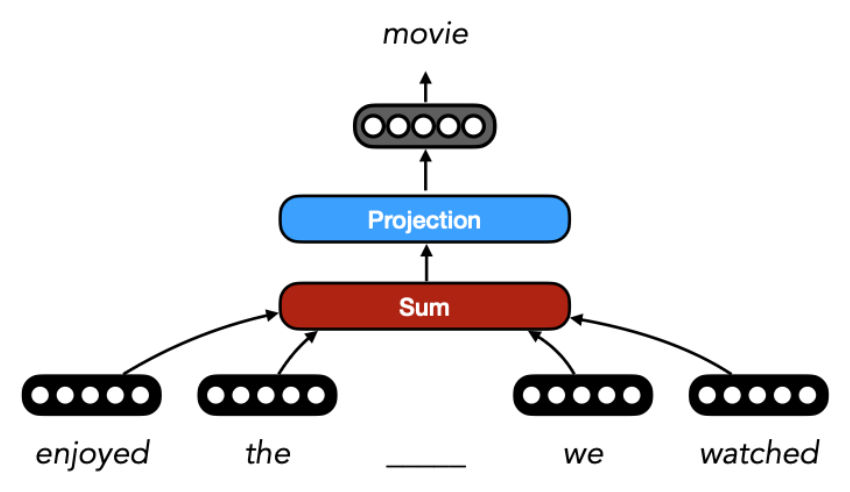
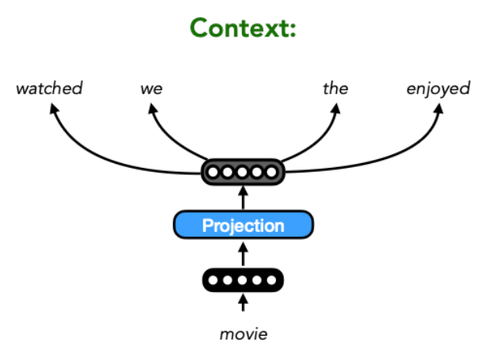
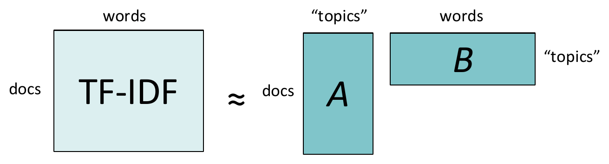
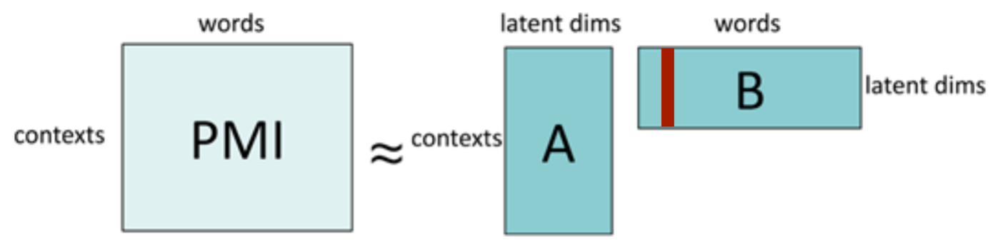
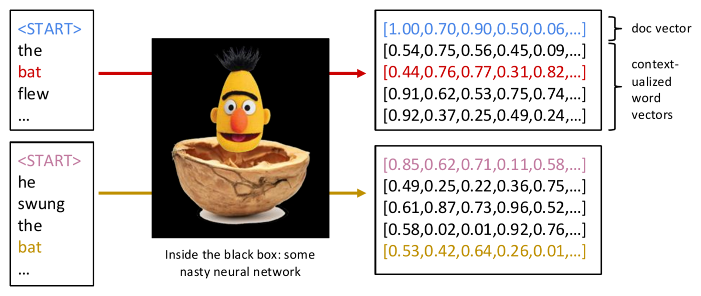

# Lecture 2 — Neural Networks and Word Embeddings

> In neural NLP, words are vectors. This lecture is about where those vectors come from: learning them from a task, learning them from raw text with word2vec, and getting them from matrix factorization (LSA, PMI). It ends with how to go from word vectors to text vectors, contextual vectors (BERT), and the classical NLP pipeline.

**After this lecture you should be able to:**
- Explain why learning embeddings only from a labelled task is limiting, and what self-supervised learning offers instead.
- State the CBOW and skip-gram objectives and explain the major conceptual difference between them.
- Compute a vocabulary-space projection $U h_t$ and turn it into probabilities with softmax.
- Describe topic detection with LSA (matrix factorization via SVD) and why it helps against the curse of dimensionality and sparsity.
- Explain word–context matrices, PMI, and the link between word2vec and PMI.
- Explain why classic word vectors cannot tell "bat" (animal) from "bat" (baseball), and how contextualized vectors fix this.

---

## 1. Where we left off

Lecture 1 set up a simple neural NLP system for the review *"I really enjoyed the movie we watched on Saturday!"*. It has three parts: **embeddings** (each word becomes a vector $x_t$), a **model** that composes them (e.g., sum-pooling $h_T = \sum_{t=0}^{T} x_t$), and a **prediction** layer (e.g., logistic regression $P(y) = \sigma(W_0 h_T)$). The learnable parameters are the **embedding matrix $E$** and the **logistic regression matrix $W_0$**. Today we focus on the first part: how do we learn good embeddings?

## 2. Learning embeddings from the task

The simplest option: treat the embeddings as parameters and train them together with the classifier. Using **backpropagation**, you compute gradients of the loss with respect to the initial embeddings $X$ and update them. The embeddings end up being whatever helps solve the task.

This is **supervised learning with a task-specific objective**. Downsides:
- **Data scarcity.** Clean labelled data is hard to collect.
- **Task-specific embeddings.** They are optimized for one task and may not help with others.

## 3. Self-supervised learning and context

> "You shall know a word by the company it keeps." — J.R. Firth, 1957

Instead of labels, use the **context** a word appears in: the set of words that occur nearby. This is the foundation of **distributional semantics**. Try filling the blanks:

- *I really enjoyed the \_\_\_\_\_ we watched on Saturday!*
- *The \_\_\_\_\_ growled at me, making me run away.*
- *I need to go to the \_\_\_\_\_ to pick up some dinner.*

You can guess the missing word from its context alone. Raw text gives you unlimited "free" training examples of this kind. That is **self-supervised learning**.

Three ways to learn embeddings this way:
- **word2vec CBOW**: predict the missing word from a window of surrounding words.
- **word2vec skip-gram**: predict the surrounding words from a given word.
- **GloVe** (Global Vectors, EMNLP 2014): mentioned but not covered.

## 4. Continuous Bag of Words (CBOW)

**Goal:** predict the missing word from a window of surrounding words. With a window of $N=2$:

$$
\max P(\text{movie} \mid \text{enjoyed}, \text{the}, \text{we}, \text{watched})
\quad\Longrightarrow\quad
\max P(x_t \mid x_{t-2}, x_{t-1}, x_{t+1}, x_{t+2})
$$

**Architecture.** Sum the context embeddings, then project to vocabulary size and apply softmax:

$$
h_t = \sum_{\substack{s=t-2 \\ s \neq t}}^{t+2} x_s,
\qquad
P\big(x_t \mid \{x_s\}_{s=t-2}^{s=t+2}\big) = \mathrm{softmax}\big(U h_t\big)
$$

Here $x_s \in \mathbb{R}^{1\times d}$ is a word embedding and $U$ is the **projection** matrix with one row of size $d$ per vocabulary word ($V$ words in total). $h_t$ is a low-dimensional representation of the context *"enjoyed the \_\_ we watched"*. Order inside the window is ignored (it is a "bag" of context words), hence the name.

  

<em>CBOW: the four context embeddings are summed into one vector, which is projected to the vocabulary to predict the blank ("movie").</em>

### Worked example: vocabulary-space projection

Say the vocabulary has just four words: *movie, show, book, shelf*. We want a probability distribution over these four words, e.g. $\langle 0.6, 0.2, 0.1, 0.1\rangle$.

Take a 3-d context vector $h_t = \langle -2.3, 0.9, 5.4\rangle$ and

$$
U = \begin{bmatrix} 1.2 & -0.3 & 0.9 \\ 0.2 & 0.4 & -2.2 \\ 8.9 & -1.9 & 6.5 \\ 4.5 & 2.2 & -0.1 \end{bmatrix}
$$

The matrix-vector product projects 3-d to 4-d. Each entry is the dot product of one row of $U$ with $h_t$. For example, for *movie*: $1.2\cdot(-2.3) + (-0.3)\cdot 0.9 + 0.9\cdot 5.4 \approx 1.8$. In full:

$$
U h_t = \langle 1.8,\ -11.9,\ 12.9,\ -8.9 \rangle
$$

These are raw scores, not probabilities. They can be negative and don't sum to 1.

### Softmax

The **softmax** turns a vector $a$ into a probability distribution:

$$
\mathrm{softmax}(a)_i = \frac{e^{a_i}}{\sum_{j=1}^{|a|} e^{a_j}}
$$

Each dimension $i$ of the output is the probability of class $i$. For example, $\mathrm{softmax}(\langle 1.8, -1.9, 2.9, -0.9\rangle) \approx \langle 0.24, 0.006, 0.73, 0.02\rangle$. Softmax will keep popping up in this course, so make sure you understand it.

### Training details
- The model is trained to **maximize the probability** of the missing word. In practice, for computational reasons, you **minimize the negative log probability**.
- The window size ($N=2$ here) is a **hyperparameter**.
- Computing softmax over the full vocabulary is expensive. In practice a **hierarchical softmax** is used (Eisenstein, 14.5.3).

## 5. Skip-gram

Skip-gram flips the direction: predict the surrounding context from a single word.

$$
\max P(\text{enjoyed}, \text{the}, \text{we}, \text{watched} \mid \text{movie})
\quad\Longrightarrow\quad
\max P(x_{t-2}, x_{t-1}, x_{t+1}, x_{t+2} \mid x_t)
$$

Take the log and treat context words as independent given the centre word. The objective decomposes into a sum:

$$
\max \log P(x_{t-2}, x_{t-1}, x_{t+1}, x_{t+2} \mid x_t)
= \max \big(\log P(x_{t-2}\mid x_t) + \log P(x_{t-1}\mid x_t) + \dots + \log P(x_{t+2}\mid x_t)\big)
= \max \sum_{s \neq t} \log P(x_s \mid x_t)
$$

Each term uses the same projection-plus-softmax as CBOW, but from a single word:

$$
P(x_s \mid x_t) = \mathrm{softmax}(U x_t)
$$

  

<em>Skip-gram reverses CBOW: one centre word ("movie") goes in, and the same projection is used to predict each surrounding word.</em>

Training details:
- Minimize the **negative log probability** of the surrounding words.
- The window size is a hyperparameter. A larger window gives more information about related words.
- Typically you set a large window (e.g., $N=10$) but randomly pick a **dynamic window size** $i \in [1, N]$, so that closer words contribute more to learning.

### CBOW vs skip-gram

| | CBOW | Skip-gram |
|---|---|---|
| Input | Context words (summed) | One centre word |
| Predicts | The missing centre word | Each surrounding context word |
| Objective | $\max P(x_t \mid \text{context})$ | $\max \sum_{s\neq t} \log P(x_s \mid x_t)$ |

## 6. Topic detection and LSA

Back to the classical TF-IDF matrix (docs × words). For **topic detection** you could cluster rows (documents) with k-means or k-medoids, then inspect and name the clusters ("news", "sports", "tech", ...). But when #words ≫ #docs this is hard: the **curse of dimensionality**, with many outliers.

**Alternative: matrix factorization.** Approximate the TF-IDF matrix $T$ as a product $T \approx AB$:
- $A$ (docs × topics): each document's vector in a latent **topic space**.
- $B$ (topics × words): each word's vector in topic space.
- A (IDF-weighted) word frequency is modelled as the dot product of the doc's and the word's topic vectors.
- #topics ≪ #words, so this is **dimensionality reduction**: $D \cdot W$ numbers become $(D+W)\cdot T$.
- Topics are interpretable in doc space (columns of $A$) and word space (rows of $B$).

  

<em>LSA approximates the big docs × words TF-IDF matrix by two thin matrices that share a small "topics" dimension.</em>

The optimization problem is

$$
\min_{A,B} \sum_{d=1}^{N}\sum_{w=1}^{M} \big(T_{dw} - A_d B_w\big)^2
$$

where $A_d$ is the $d$-th row of $A$ and $B_w$ the $w$-th column of $B$. This is **latent semantic analysis (LSA)**.

You compute it with **singular value decomposition (SVD)**: $T = U S V^\top$.
- Columns of $U$ and $V$ are orthonormal bases.
- $S$ is diagonal, with values in decreasing order. Each value captures the "importance" of a topic (how much variation in the corpus it explains).
- For $k$ topics, keep the first $k$ columns of $U$ and $V$ and the first $k$ rows and columns of $S$, giving $U', S', V'$. Then e.g. $A = U'$, $B = S'V'^\top$, or $A = U'S'$, $B = V'^\top$.

LSA fixes the curse of dimensionality: cluster, classify or regress using $A$ (topic space) instead of the original TF-IDF matrix (word space).

## 7. Dense word vectors, word–context matrices and PMI

Which pair is more closely related: (car, bus) or (car, astronaut)? To compare two docs you can take the cosine of rows of the TF-IDF matrix. To compare two words, take the cosine of columns.

**The sparsity problem.** *"Do you love men?"* and *"Adorest thou the likes of Adam?"* mean similar things, but share no words, so their TF-IDF cosine is 0. The same problem hits word comparisons. The fix: move from sparse to **dense vectors**. With LSA, use the **columns of $B$** as dense word vectors.

**From documents to local contexts.** Treating a whole doc as one bag of words loses all information about word proximity and syntax. Instead, use **local contexts**: windows of $L$ (e.g., 3) words to the left and right of the target word. Now the rows of the matrix $M$ are contexts, not docs.

What goes in $M[c,w]$?
- Same as TF-IDF, with contexts as "pseudo-docs": $M[c,w] = \text{TF-IDF}(c,w)$.
- Any other measure of statistical association, e.g. **pointwise mutual information**: $M[c,w] = \mathrm{PMI}(c,w)$, i.e. how much more likely $c$ and $w$ are to occur together than if they were independent. Formally, $\mathrm{PMI}(c,w) = \log \frac{P(c,w)}{P(c)\,P(w)}$.

**Key connection:** word2vec effectively **factors a PMI matrix** and uses the columns of $B$ as word vectors. So the neural method and the matrix-factorization method are closely related.

  

<em>Same picture as LSA, but with a PMI word–context matrix; the highlighted column of B is one word's dense vector.</em>

## 8. From words to texts

How do you represent a sentence, paragraph or document?
- **Typical approach:** take the sum or average of the word vectors. With one-hot word vectors (exactly one 1, rest 0), this is roughly a bag of words.
- **More recently:** learn vectors for longer units directly: Cr5, sent2vec; convolutional neural networks; recurrent neural networks (e.g., LSTM, ELMo); Transformer-based models (e.g., BERT, GPT-*).

## 9. Contextualized word vectors and BERT

Compare *"The bat flew into the cave."* with *"He swung the bat and hit a home run."* Classic word vectors like word2vec give both "bat"s the **same vector**, so they cannot tell them apart.

**Contextualized word vectors** fix this: each word's vector depends on the whole sentence. **BERT** (Google Research, 2018) is the standard example. You feed in a sentence; a neural network (a black box for now) outputs a vector for every token, plus a vector for the whole doc at the `<START>` position. The two "bat"s now get different vectors.

  

<em>BERT outputs a doc vector at &lt;START&gt; plus one vector per token; notice the red and gold "bat" vectors differ because their sentences differ.</em>

## 10. The classical NLP pipeline

Classical NLP tools (Stanford CoreNLP, nltk, spaCy) run a fixed sequence of steps:
1. **Tokenization**
2. **Sentence splitting**
3. **Part-of-speech (POS) tagging**
4. **Named-entity recognition (NER)**
5. **Coreference resolution**
6. **Parsing**: shallow parsing (chunking), constituency parsing, dependency parsing

Problems with a sequential pipeline:
- **Early errors propagate** downstream.
- A fixed order is not optimal for every case. Syntax is usually done before semantics, but semantics might help infer syntax.

Hence current research learns all tasks **jointly**.

**Today's trend: generative language models** (e.g., GPT-*, ChatGPT). Input is text, output is text. Many NLP tasks can be cast in this framework by **prompting** the model with the right input.

---

## Key takeaways
- Embeddings learned only from a labelled task suffer from data scarcity and are task-specific.
- Self-supervised learning uses context ("know a word by the company it keeps") to learn embeddings from raw text.
- CBOW predicts the centre word from its summed context; skip-gram predicts each context word from the centre word.
- Both project into vocabulary space with $U$ and use softmax to get a probability distribution over words.
- LSA factorizes the TF-IDF matrix with SVD into dense doc and word vectors in a low-dimensional topic space.
- Dense vectors fix the sparsity problem (zero cosine for texts with no shared words).
- word2vec is closely related to factorizing a word–context PMI matrix.
- Classic word vectors give one vector per word type; contextualized models like BERT give one per occurrence.

## Check yourself

What is the major conceptual difference between the CBOW and skip-gram methods for training word embeddings?

CBOW predicts the missing (centre) word from the window of surrounding words. Skip-gram does the reverse: it predicts the surrounding context words from the single centre word.

What are the downsides of learning embeddings directly from a supervised task?

Data scarcity (clean labelled data is hard to collect), and the embeddings are task-specific, optimized for one task and maybe not others.

Why can't you use $U h_t$ directly as a probability distribution, and what do you do instead?

Its entries are raw scores: they can be negative and don't sum to 1 (e.g., $\langle 1.8, -11.9, 12.9, -8.9\rangle$). Apply softmax, $e^{a_i}/\sum_j e^{a_j}$, to get a valid distribution.

Why is the TF-IDF cosine between "Do you love men?" and "Adorest thou the likes of Adam?" zero, and how can you fix it?

The sentences share no words, so their sparse vectors have no overlapping non-zero entries. Fix it with dense vectors, e.g. from LSA (columns of $B$) or word2vec.

In LSA via SVD, how do you get $k$ topics, and what does $S$ tell you?

Keep the first $k$ columns of $U$ and $V$ and the first $k$ rows and columns of $S$. $S$ is diagonal with decreasing values; each value measures how important a topic is (how much corpus variation it captures).

Why does word2vec give the same vector to "bat" in "The bat flew into the cave" and "He swung the bat"?

word2vec learns one vector per word type, regardless of context. Contextualized models such as BERT compute a different vector for each occurrence based on the surrounding sentence.

---
📚 Want to go deeper? See the **Lecture 2** section of [Further Reading](Further-Reading.md#2--neural-networks-and-word-embeddings).
