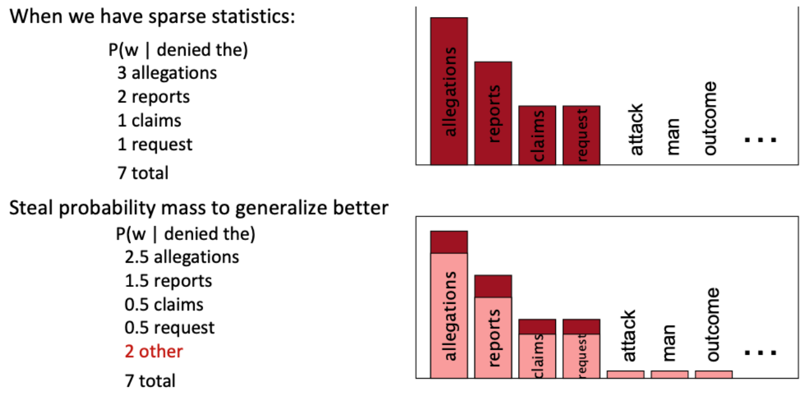
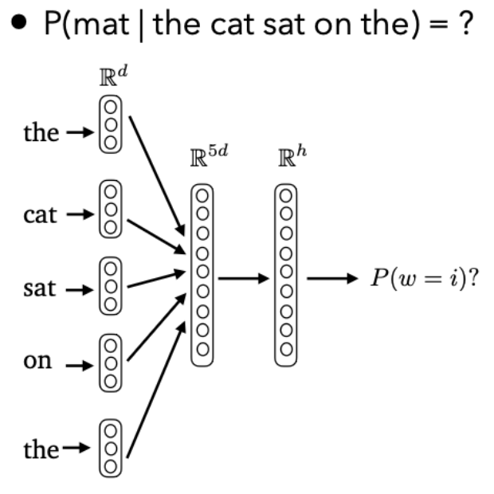
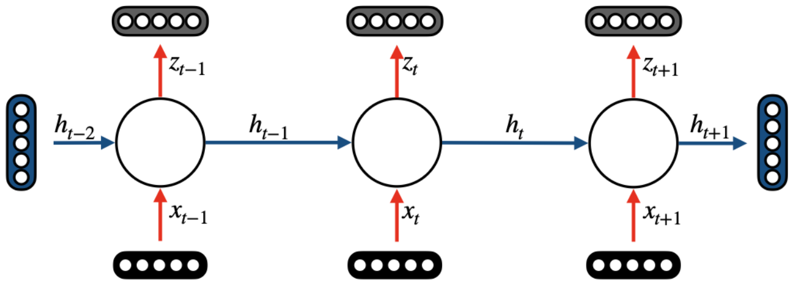
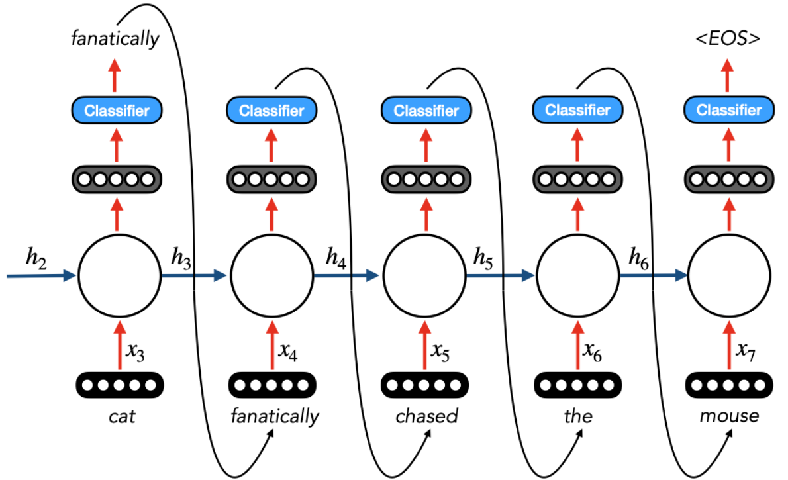

# Lecture 3 — Language Modeling (Part 1)

> A language model assigns a probability to a sequence of words. This lecture builds language models from simple counting (n-grams), shows how they are evaluated (perplexity) and where they break, and then moves to neural models: fixed-context neural LMs and recurrent neural networks (RNNs).

**After this lecture you should be able to:**
- Explain what a language model computes and decompose a sentence probability with the chain rule
- Apply the Markov assumption to build unigram, bigram and n-gram models from counts
- Define perplexity, compute it for a uniform model, and explain what it measures
- Name the main shortcomings of n-gram LMs and the four families of smoothing
- Describe a fixed-context neural LM, including the shapes of $`W`$ and $`U`$
- Write down the Elman RNN equations and explain how an RNN handles sequences of any length

---

## 1. What is a language model?

A **language model (LM)** is a probabilistic model of a sequence of tokens: how likely is this phrase, sentence or document?

A sequence $`w_1, w_2, \dots, w_n`$ is modelled as a **joint distribution** over its tokens:

```math
P(w_1, w_2, w_3, \dots, w_n)
```

**Applications.** Predicting the next words matters in many settings:
- **Text generation:** $`P(\text{a } \textbf{smooth} \text{ finish}) > P(\text{a } \textbf{flat} \text{ finish})`$
- **Spell checking:** $`P(\text{high school } \textbf{principal}) > P(\text{high school } \textbf{principle})`$
- **Modern uses:** information extraction, question answering, and more.

## 2. The chain rule and counting

To compute the joint probability, use the **chain rule**. Each word is conditioned on everything before it (its **prefix**):

```math
P(w_1, \dots, w_n) = P(w_1)\,P(w_2 \mid w_1)\,P(w_3 \mid w_1, w_2)\cdots P(w_n \mid w_1, \dots, w_{n-1}) = \prod_i P(w_i \mid w_1, \dots, w_{i-1})
```

Example, "the cat sat on the mat":

```math
P(\text{the})\cdot P(\text{cat}\mid\text{the})\cdot P(\text{sat}\mid\text{the cat})\cdot P(\text{on}\mid\text{the cat sat})\cdot P(\text{the}\mid\text{the cat sat on})\cdot P(\text{mat}\mid\text{the cat sat on the})
```

**Count-based modeling** estimates each factor by counting sequences in a corpus:

```math
P(\text{sat} \mid \text{the cat}) = \frac{\text{count}(\text{the cat sat})}{\text{count}(\text{the cat})}
```

A note on terms:
- **Word type:** a unique word in the vocabulary $`V`$.
- **Token:** one occurrence of a word type in the corpus.

**Why counting full histories fails.** With vocabulary size $`V`$, there are $`V^n`$ possible sequences of length $`n`$. A typical vocabulary has about 40K words. Even sentences of length at most 11 give more than $`4 \times 10^{50}`$ possible sequences. That is more than the number of atoms in the earth. You will never see most of them, so their counts are zero.

## 3. The Markov assumption and n-gram models

The **Markov assumption**: use only the recent past to predict the next word. You trade some modelling capacity for far fewer parameters.

- 1st order: $`P(\text{mat} \mid \text{the cat sat on the}) \approx P(\text{mat} \mid \text{the})`$
- 2nd order: $`P(\text{mat} \mid \text{the cat sat on the}) \approx P(\text{mat} \mid \text{on the})`$

A **k-th order Markov** model keeps only the last $`k`$ words:

```math
P(w_i \mid w_1 \dots w_{i-1}) \approx P(w_i \mid w_{i-k} \dots w_{i-1}) \quad\Rightarrow\quad P(w_1 \dots w_n) \approx \prod_i P(w_i \mid w_{i-k} \dots w_{i-1})
```

(ignoring $`w_j`$ for $`j \lt  0`$).

This gives **n-gram models**:
- **Unigram:** $`P(w_1, \dots, w_n) = \prod_{i=1}^n P(w_i)`$
- **Bigram:** $`P(w_1, \dots, w_n) = \prod_{i=1}^n P(w_i \mid w_{i-1})`$
- Trigram, 4-gram, and so on.

Larger $`n`$ gives better models, but at higher cost, and only assuming infinite data.

**Generation.** You generate text by sampling one word at a time from these conditional probabilities. In class, unigram output was word salad, bigram output locally fluent, and trigram output much closer to real text.

**Limitation: long-range dependencies.** In "Alice/Bob could not go to work that day because she/he had a doctor's appointment", choosing *she* or *he* depends on a word far back. You would need at least a 9-gram model to capture it.

## 4. Evaluating language models

A good LM gives higher probability to typical, grammatical sentences. The research process:
- Train parameters on a training corpus. Assume observed sentences are good sentences.
- Test on a **different, unseen** corpus. Training on any part of the test set is not acceptable: the model would just memorise it, and the score would no longer tell you how well it generalises.
- Evaluate with a suitable metric.

**Extrinsic evaluation:** train the LM, apply it to a downstream task, measure accuracy. It is directly tied to what you care about, but expensive, slow, and gives only indirect feedback.

**Intrinsic evaluation** measures the LM itself, without a downstream task. The standard metric is perplexity.

## 5. Perplexity

**Perplexity (ppl)** measures how well a probability distribution (an LM) predicts a sample. For a test corpus $`S`$ with sentences $`S^1, \dots, S^n`$ and $`W`$ total words:

```math
\text{ppl}(S) = 2^{x}, \qquad x = -\frac{1}{W}\sum_{i=1}^{n} \log_2 P(S^i)
```

The exponent $`x`$ is the **cross-entropy**: the average negative log-probability per word. So perplexity is the exponentiated token-level negative log-likelihood.

For a unigram model, $`P(S^i) = \prod_j P(w^i_j)`$, so $`x = -\frac{1}{W}\sum_{i=1}^{n}\sum_{j=1}^{m}\log_2 P(w^i_j)`$.

**Lower is better.** Minimising perplexity is the same as maximising the probability of the test corpus.

**Intuition (uniform model).** Suppose every word is equally likely: $`P(w_i \mid w_{i-n}, \dots, w_{i-1}) = \frac{1}{|V|}`$. Then

```math
\text{ppl} = 2^{-\frac{1}{W}\cdot W \cdot \log_2 \frac{1}{|V|}} = |V|
```

Perplexity measures the model's **uncertainty about the next word**.

**Why logs?** Multiplying many small probabilities underflows; summing logs is stable. In theory perplexity uses base 2; in practice the base does not matter, and $`e`$ is common.

**Perplexity and vocabulary.** The uniform case shows that perplexity depends on $`|V|`$. Models with different vocabularies are therefore not directly comparable by perplexity.

| Pros | Cons |
|---|---|
| Easy to compute | Train and test domains must match |
| Standardised | May not reflect end-task performance |
| Directly useful (e.g. to pick the more likely correction) | $`\log 0`$ is undefined |
| Nice theoretical interpretation (matching distributions) | Can be "cheated" by predicting common tokens |
| | Size of the test set matters |
| | Sensitive to low-probability tokens/sentences |

## 6. Shortcomings of n-gram LMs

**Exponential decay of counts.** Longer contexts are seen far less often. In one corpus, *to* appears 1M times, *go to* 50,000 times, *to go to* 1,500 times and *want to go to* only 100 times. Counts get sparse fast, yet you often need information from 5+ words away.

**Unseen n-grams.** The test set may contain n-grams never seen in training. Train on Google News and test on Shakespeare: $`P(\text{affray} \mid \text{voice doth us}) = 0`$. One zero makes $`P(\text{test corpus}) = 0`$, and perplexity becomes undefined.

**Shakespeare as a corpus.** It has $`N = 884{,}647`$ tokens and $`V = 29{,}066`$ word types. Shakespeare produced about 300K bigram types out of $`V^2 \approx 844`$M possible bigrams. So 99.96% of possible bigrams were never seen.

**Sparsity is built into language.** By Zipf's law, a word's probability scales inversely with its frequency rank: $`p(w_i) \propto 1/i`$. There is a long tail of rare words, and any finite corpus will miss many combinations.

## 7. Smoothing

**Smoothing** makes sure every probability in the model is non-zero. The idea: steal some probability mass from seen events to give to unseen ones. For example, if after "denied the" you saw *allegations* 3 times, *reports* 2, *claims* 1 and *request* 1 (7 total), you might reassign 2.5, 1.5, 0.5, 0.5, and give 2 to "other" words like *attack* or *outcome*.

<p align="center">
  
</p>
<p align="center"><em>Smoothing shaves a little mass off each seen word (dark tops) and spreads it over unseen words, so none get probability zero.</em></p>

| Family | Idea |
|---|---|
| **Additive** | Add a small amount to all counts |
| **Discounting** | Move probability mass from observed n-grams to unobserved ones |
| **Back-off** | Use a lower-order n-gram if the higher-order one is too sparse |
| **Interpolation** | Combine n-grams of different orders |

**Laplace (add-$`\alpha`$) smoothing**, the simplest heuristic: add $`\alpha`$ to all counts and renormalise. The bigram maximum-likelihood estimate

```math
P(w_i \mid w_{i-1}) = \frac{C(w_{i-1}, w_i)}{C(w_{i-1})}
```

becomes

```math
P(w_i \mid w_{i-1}) = \frac{C(w_{i-1}, w_i) + \alpha}{C(w_{i-1}) + \alpha|V|}
```

The $`\alpha|V|`$ in the denominator keeps the distribution summing to 1.

**Linear interpolation** mixes models of different orders:

```math
\hat P(w_i \mid w_{i-1}, w_{i-2}) = \lambda_1 P(w_i \mid w_{i-1}, w_{i-2}) + \lambda_2 P(w_i \mid w_{i-1}) + \lambda_3 P(w_i), \qquad \sum_i \lambda_i = 1
```

It has strong empirical performance.

## 8. Another problem: no notion of similarity

n-gram LMs treat every word and prefix as independent. There is no similarity unless sequences literally overlap. "students opened their ___", "pupils opened their ___", "scholars opened their ___" and "students attentively perused their ___" share nothing in an n-gram table. Ideally, the model should share information across such similar prefixes. Neural LMs do this through embeddings.

## 9. Fixed-context neural language models

A neural model composes word embeddings into a vector $`h`$ for the prefix, then predicts the next word from it.

**Vocabulary projection + softmax.** Given a $`d`$-dimensional representation of a prefix:
1. Project it to a $`|V|`$-dimensional vector with a matrix-vector product (a "linear" or "feedforward" layer).
2. Apply softmax to turn it into a probability distribution over the whole vocabulary.

For "students opened their", the distribution might put high mass on *books* and *laptops*.

**Architecture** for $`P(\text{mat} \mid \text{the cat sat on the})`$ with a window of $`n = 5`$ words, each embedding in $`\mathbb{R}^d`$:
- **Input layer:** concatenate the embeddings: $`\mathbf{x} = [\mathbf{e}_{\text{the}}; \mathbf{e}_{\text{cat}}; \mathbf{e}_{\text{sat}}; \mathbf{e}_{\text{on}}; \mathbf{e}_{\text{the}}] \in \mathbb{R}^{dn}`$
- **Hidden layer:** $`\mathbf{h} = \tanh(\mathbf{W}\mathbf{x} + \mathbf{b}) \in \mathbb{R}^{h}`$
- **Output layer:** $`\mathbf{z} = \mathbf{U}\mathbf{h} \in \mathbb{R}^{|V|}`$, and $`P(w = i \mid \text{the cat sat on the}) = \text{softmax}_i(\mathbf{z}) = \dfrac{e^{z_i}}{\sum_k e^{z_k}}`$

So $`\mathbf{W} \in \mathbb{R}^{h \times dn}`$ and $`\mathbf{U} \in \mathbb{R}^{|V| \times h}`$.

<p align="center">
  
</p>
<p align="center"><em>The five context embeddings are concatenated (R^5d), passed through the hidden layer (R^h), then projected to a softmax over the vocabulary.</em></p>

This model most resembles **CBOW**: both predict a word from a window of context word embeddings.

| Advantages | Disadvantages |
|---|---|
| No sparsity problem: softmax gives every sequence non-zero probability | Fixed windows are still too small for long-range dependencies |
| Much smaller model: size depends on the number of weights, not the number of sequences | A larger window makes $`\mathbf{W}`$ larger (more expensive) |
| | Weights in $`\mathbf{W}`$ are not shared across positions in the window (inefficient) |

**Sequences vary in length.** "The cat chased the mouse" can grow into "The starving cat, who had not eaten in six days, fanatically chased the elusive mouse". A 5-word window works for $`P(\text{mouse} \mid \text{cat fanatically chased after the})`$ but fails for $`P(\text{mouse} \mid \text{fanatically chased after the elusive})`$: *cat* has dropped out of the window.

## 10. Recurrent neural networks (RNNs)

An **RNN** is a neural network with a feedback loop. At each time step $`t`$ it takes input $`x_t`$, updates a **state** $`h_t`$ using the previous state, and produces output $`z_t`$.

**Unrolling.** Unrolling the RNN across all time steps gives the full computation graph: a chain of identical units, each passing $`h_t`$ to the next. This lets the model learn from the entire history, regardless of length.

<p align="center">
  
</p>
<p align="center"><em>The same unit repeats at every step: the hidden state h flows left to right, carrying the history forward.</em></p>

How you use an RNN depends on the task:
- **Classification:** put a classifier on the last output, $`P(y) = \sigma(W_o z_T)`$ (binary) or $`P(y) = \text{softmax}(W_o z_T)`$ (multi-class). You use the last unit because it is the only one that has seen the whole sequence.
- **Sequence labeling:** put a classifier on every output, e.g. part-of-speech tags for "cat fanatically chased the mouse".
- **Text generation:** predict the next word at each step and feed it back in as the next input, until an `<EOS>` token.

<p align="center">
  
</p>
<p align="center"><em>In generation, each predicted word loops back to become the next input, until the model outputs &lt;EOS&gt;.</em></p>

RNNs trained on Shakespeare or Wikipedia generate text with a convincing style and format, even if it does not make sense.

## 11. The Elman network

The classical RNN is the **Elman network**:

```math
h_t = \sigma(W_{hx}x_t + W_{hh}h_{t-1} + b_h)
```

```math
z_t = \sigma(W_{zh}h_t + b_z)
```

Two key components:
1. **Memory:** the state $`h`$ carries information across time steps. The term $`W_{hh}h_{t-1}`$ is what lets the model remember earlier tokens.
2. **Shared parameters:** $`W_{hx}, W_{hh}, W_{zh}`$ (and the biases) are the same at every time step. So the model size does not grow with sequence length.

To start the recurrence you need an initial state $`h_0`$ (commonly a zero vector).

**Objective.** Learn the parameter matrices $`W_{hh}`$, $`W_{hx}`$, $`W_{zh}`$ so that the RNN can represent textual sequences. How to train them (and the problems that arise) is covered in Lecture 4.

---

## Key takeaways
- An LM estimates $`P(w_1, \dots, w_n)`$; the chain rule factors it into next-word predictions.
- Counting full histories is impossible: there are $`V^n`$ possible sequences.
- The Markov assumption gives n-gram models: condition only on the last $`k`$ words.
- Perplexity $`= 2^{\text{cross-entropy}}`$; lower is better; a uniform model has perplexity $`|V|`$.
- n-gram LMs suffer from sparsity (zero counts, Zipf's long tail) and need smoothing: additive, discounting, back-off, interpolation.
- n-grams share nothing between similar prefixes; neural LMs fix this with embeddings.
- Fixed-context neural LMs remove sparsity but still have a fixed window.
- RNNs share weights across time steps and can, in theory, model unbounded context.

## Check yourself

<details>
<summary>Do you see any problems with estimating probabilities by counting full sequences?</summary>

The number of possible sequences of length $`n`$ is $`V^n`$. With $`V \approx`$ 40K and length up to 11, that is over $`4 \times 10^{50}`$ sequences. Almost all have zero counts in any corpus.
</details>

<details>
<summary>An n-gram model assigns every word probability $`1/|V|`$. What is its perplexity on a test corpus?</summary>

$`\text{ppl} = 2^{-\frac{1}{W} \cdot W \log_2 (1/|V|)} = |V|`$. Every word is equally likely, so the model is maximally uncertain.
</details>

<details>
<summary>Why can a single unseen n-gram break perplexity, and how do you fix it?</summary>

If any test n-gram has probability 0, the corpus probability is 0, $`\log 0`$ is undefined, and so is perplexity. Smoothing (e.g. add-$`\alpha`$, interpolation) gives every n-gram non-zero probability.
</details>

<details>
<summary>In the fixed-context neural LM, what are the dimensions of W and U?</summary>

$`\mathbf{W}`$ maps $`\mathbb{R}^{dn} \to \mathbb{R}^h`$, so it is $`h \times dn`$. $`\mathbf{U}`$ maps $`\mathbb{R}^h \to \mathbb{R}^{|V|}`$, so it is $`|V| \times h`$.
</details>

<details>
<summary>Which word embedding algorithm do fixed-context language models resemble the most?</summary>

CBOW: both predict a word from a window of context word embeddings.
</details>

<details>
<summary>What part of the Elman network lets it maintain a state of previous tokens?</summary>

The previous hidden state $`h_{t-1}`$, fed in through $`W_{hh}h_{t-1}`$. Together with weights shared across time steps, this lets the RNN handle sequences of any length.
</details>

---
📚 Want to go deeper? See the **Lecture 3** section of [Further Reading](Further-Reading.md#3--language-modeling-part-1).
