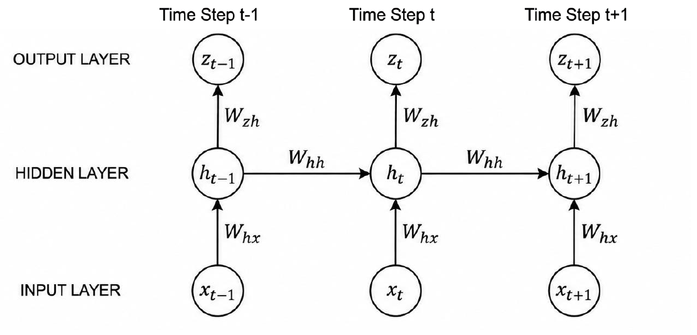
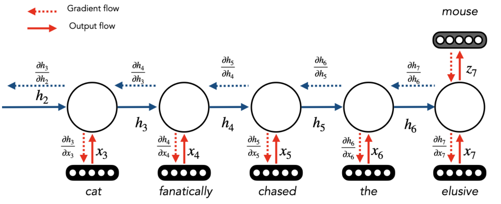
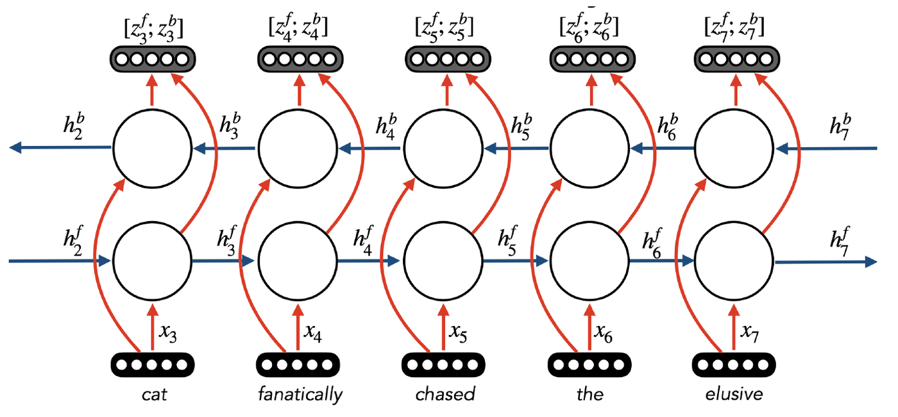
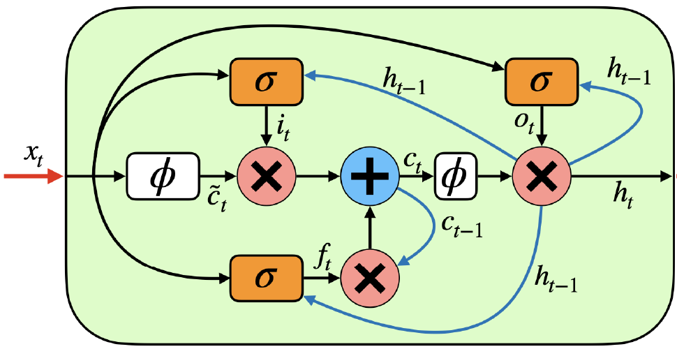

# Lecture 4 — Language Modeling (Part 2): RNNs, LSTMs and GRUs

> This lecture looks at how recurrent neural networks (RNNs) are trained, why vanilla RNNs struggle with long-range dependencies (vanishing gradients), and how gated variants (LSTMs and GRUs) fix this. These ideas are the bridge from n-gram models to modern neural language models.

**After this lecture you should be able to:**
- Write down the Elman network equations and say what each parameter matrix does.
- Explain why an unrolled RNN is a feed-forward network whose depth equals the sequence length, and apply the chain rule to compute gradients (backpropagation through time).
- Describe deep (stacked) and bidirectional RNNs, and say when a bidirectional RNN can be used.
- Explain why gradients vanish in vanilla RNNs and how gating reduces the problem.
- Write the LSTM and GRU equations and explain the role of each gate.
- Compare vanilla RNNs, LSTMs and GRUs, including their trade-offs.

---

Where we left off: n-gram and fixed-context neural LMs can only look at a limited window of history. RNNs can, in theory, model an unbounded context, and the model size does not grow with the context because the same weights are reused at every time step.

## 1. The Elman network (classical RNN)

The **Elman network** is the classical ("vanilla") RNN. At each time step $`t`$ it reads input $`x_t`$, updates the hidden state $`h_t`$, and produces an output $`z_t`$:

```math
h_t = \sigma(W_{hx} x_t + W_{hh} h_{t-1} + b_h)
```

```math
z_t = \sigma(W_{zh} h_t + b_z)
```

- $`W_{hx}`$ maps the input to the hidden state.
- $`W_{hh}`$ maps the previous hidden state to the new one. The term $`W_{hh} h_{t-1}`$ is what lets the model keep a **state** of the tokens seen so far.
- $`W_{zh}`$ maps the hidden state to the output.
- $`\sigma`$ is the sigmoid activation. The initial state $`h_0`$ must be chosen too (commonly a vector of zeros).

Two major components:
1. **Memory** is maintained across time steps by the state $`h`$.
2. **Parameter matrices are shared** across all time steps.

<p align="center">
  
</p>
<p align="center"><em>The same W_hx, W_hh and W_zh appear at every time step; only W_hh links one hidden state to the next.</em></p>

**Learning objective:** learn $`W_{hh}`$, $`W_{hx}`$, $`W_{zh}`$ (and biases) such that the RNN can represent textual sequences, i.e. predict the next token well.

## 2. An RNN is a feed-forward network with dynamic depth

If you **unroll** the RNN across all time steps, you get the full computation graph: one copy of the cell per token, connected through $`h_{t-1} \to h_t`$. So:

- An RNN is a **feed-forward network (FFN) with dynamic depth**.
- **Depth = length of the input sequence.**

This means we can train it with the same tool we use for FFNs: backpropagation.

## 3. Backpropagation review (FFNs)

Take a small FFN with input $`x`$, two hidden layers and one output unit:

```math
h_1 = \phi_1(W_0 x), \quad h_2 = \phi_2(W_1 h_1), \quad u = W_{out} h_2 = w^o_1 \phi_{12} + w^o_2 \phi_{22} + w^o_3 \phi_{32}, \quad P(\hat y) = \phi_o(u)
```

with cross-entropy loss $`\mathcal{L}(\hat y, y) = -y \log P(\hat y)`$.

**Step 1: gradient w.r.t. a unit in the last hidden layer.** Apply the chain rule:

```math
\frac{\partial \mathcal{L}}{\partial \phi_{12}} = \frac{\partial \mathcal{L}}{\partial \hat y}\frac{\partial \hat y}{\partial u}\frac{\partial u}{\partial \phi_{12}} = \frac{\partial \mathcal{L}}{\partial \hat y}\frac{\partial \phi_o(u)}{\partial u}\, w^o_1
```

- $`\frac{\partial \mathcal{L}}{\partial \hat y}`$ depends on the label $`y`$.
- $`\frac{\partial \phi_o(u)}{\partial u}`$ depends on the output activation $`\phi_o`$.
- $`\frac{\partial u}{\partial \phi_{12}} = w^o_1`$, the weight connecting that unit to the output.

For $`\phi_{22}`$ the only change is the last factor: $`w^o_2`$ instead of $`w^o_1`$.

**Step 2: go one layer further back.** For the first hidden layer, let $`v = w^{\ell=1}_{11}\phi_{11} + w^{\ell=1}_{21}\phi_{21} + w^{\ell=1}_{31}\phi_{31}`$ be the input to $`\phi_{12}`$. Then:

```math
\frac{\partial \mathcal{L}}{\partial \phi_{11}} = \underbrace{\frac{\partial \mathcal{L}}{\partial \hat y}\frac{\partial \phi_o(u)}{\partial u} w^o_1}_{\text{already computed}} \cdot \frac{\partial \phi_{12}(v)}{\partial v} \cdot w^{\ell=1}_{11}
```

The key point: each layer **reuses the gradient already computed** for the layer above and multiplies in one local derivative and one weight. (Strictly, $`\phi_{11}`$ feeds all three units in $`h_2`$, so its full gradient sums one such term per path.)

## 4. Backpropagation through time (BPTT)

Apply the same idea to the unrolled RNN. Name the pre-activations $`v_t = W_{zh} h_t + b_z`$ and $`u_t = W_{hx} x_t + W_{hh} h_{t-1} + b_h`$. The local derivatives are:

```math
\frac{\partial z_t}{\partial h_t} = \frac{\partial \sigma(v_t)}{\partial v_t} W_{zh}, \qquad \frac{\partial h_t}{\partial h_{t-1}} = \frac{\partial \sigma(u_t)}{\partial u_t} W_{hh}
```

To go further back in time, chain them:

```math
\frac{\partial z_t}{\partial h_{t-2}} = \frac{\partial z_t}{\partial h_t}\frac{\partial h_t}{\partial h_{t-1}}\frac{\partial h_{t-1}}{\partial h_{t-2}} = \frac{\partial \sigma(v_t)}{\partial v_t} W_{zh}\, \frac{\partial \sigma(u_t)}{\partial u_t} W_{hh}\, \frac{\partial \sigma(u_{t-1})}{\partial u_{t-1}} W_{hh}
```

Note that the two $`W_{hh}`$ factors are **the same matrix**, because weights are shared across time. As a result, the gradient for a shared weight such as $`W_{hh}`$ is the **sum of its contributions at every time step**.

In the running example "cat fanatically chased the elusive → *mouse*", the loss at the last step sends gradient back through $`h_7 \to h_6 \to \dots \to h_2`$, and also down into each input $`x_t`$.

<p align="center">
  
</p>
<p align="center"><em>Gradient from the loss at "mouse" (dashed arrows) flows backwards through every hidden state and down into every input embedding.</em></p>

## 5. RNNs in practice

- Computing gradients by hand is hard, but it is a good way to sanity-check your network's expected behaviour.
- Modern deep learning libraries use **automatic differentiation**: you define only the **forward pass**, and gradients are computed for you.
- In this course you use PyTorch, so you will not compute gradients by hand.

## 6. Deep and bidirectional RNNs

**Deep (stacked) RNNs:** stack several recurrent layers. The outputs $`z^1_t`$ of layer 1 are the inputs to layer 2, and so on. Each layer has its own hidden states $`h^\ell_t`$. Gradients flow back both through time and down through the layers. Typically **3–4 layers** are used.

**Bidirectional RNNs:** run one RNN left-to-right (states $`h^f_t`$) and another right-to-left ($`h^b_t`$).
- **Concatenate** the outputs at each step: $`[z^f_t; z^b_t]`$. You can also take the mean or max.
- The forward and backward RNNs have **separate parameters**.
- **Important:** only useful when you are allowed to use the future text for the task (e.g. classifying or tagging a full sentence). You **cannot** use them for left-to-right language modeling, where the future is what you predict.

<p align="center">
  
</p>
<p align="center"><em>Each input feeds both a left-to-right and a right-to-left RNN, and their outputs are concatenated per position as [z^f; z^b].</em></p>

## 7. Issues with RNNs: long-range dependencies

The hidden state is overwritten at every step. After many steps of overwriting, it is hard to learn long-range dependencies. Nearby words should affect each other more than distant ones, but RNNs make it hard to learn *any* long-range interaction.

In-class example:

> They tuned, discussed for a moment, then struck up a lively jig. Everyone joined in, turning the courtyard into an even more chaotic scene, people now dancing in circles, swinging and spinning in circles, everyone making up their own dance steps. I felt my feet tapping, my body wanting to move. Aside from writing, I've always loved **dancing**.

Predicting "dancing" at the end benefits from context many words earlier.

## 8. Vanishing gradients

Generalising the BPTT chain over $`T`$ steps:

```math
\frac{\partial h_t}{\partial h_{t-T}} = \prod_{i=t-T}^{t} \frac{\partial h_i}{\partial h_{i-1}} = \prod_{i=t-T}^{t} \frac{\partial \sigma(u_i)}{\partial u_i} W_{hh}
```

This is a **product of many factors**:
- $`\frac{\partial \sigma(u_i)}{\partial u_i}`$ is **less than 1** for many activation functions. The sigmoid's derivative is at most 0.25.
- $`W_{hh}`$ is typically small (because of regularisation).

Multiplying many small numbers gives a number close to zero. So long unrolled networks **crush/squash the gradients** that flow back to earlier time steps. Early words then get almost no learning signal. This is a typical problem in many RNNs, especially Elman (vanilla) RNNs because of the sigmoid.

## 9. Gated RNNs

The fix: use **gates** so the gradient is not dampened at every step.

| Elman network | Gated network (abstraction) |
|---|---|
| $`h_t = \sigma(W_{hx} x_t + W_{hh} h_{t-1} + b_h)`$ | $`h_t = h_{t-1} \odot \mathbf{f} + \text{func}(x_t)`$ |

- The **gate value** $`\mathbf{f}`$ decides how much information from the previous hidden state moves to the next step, with $`0 < f < 1`$.
- Because $`h_{t-1}`$ is **no longer inside the activation function**, it is not automatically squashed. This reduces vanishing gradients.

## 10. Long short-term memory (LSTM)

The LSTM adds a **cell state** $`c_t`$ and three gates. $`\sigma`$ is the sigmoid and $`\phi`$ is a squashing nonlinearity (typically tanh).

**Gates:**

```math
f_t = \sigma(W_{fx} x_t + W_{fh} h_{t-1} + b_f)
```

```math
i_t = \sigma(W_{ix} x_t + W_{ih} h_{t-1} + b_i)
```

```math
o_t = \sigma(W_{ox} x_t + W_{oh} h_{t-1} + b_o)
```

**State updates:**

```math
\tilde c_t = \phi(W_{cx} x_t + W_{ch} h_{t-1} + b_c)
```

```math
c_t = i_t \times \tilde c_t + f_t \times c_{t-1}
```

```math
h_t = o_t \times \phi(c_t)
```

- The hidden state $`h_{t-1}`$ now acts as **short-term memory**.
- The cell state $`c_t`$ tracks **longer-term dependencies**.

<p align="center">
  
</p>
<p align="center"><em>Follow the cell state path through the blue "+": the old memory c_(t-1) is only multiplied by the forget gate f_t, never squashed by an activation.</em></p>

| Gate | Role | Value 1 | Value 0 |
|---|---|---|---|
| Forget $`f_t`$ | How much old memory $`c_{t-1}`$ is kept | Remember the past | Forget everything up to now |
| Input $`i_t`$ | How much new info $`\tilde c_t`$ is added to memory | Add the new candidate fully | Ignore the current time step |
| Output $`o_t`$ | How much of the cell state is exposed as $`h_t`$, which influences the gate values at the next step | Expose fully | Hide the cell state |

In class, each gate was walked through on the sentence "I went to **the lecture**", reading one word at a time.

**What does the cell state track?** If you visualise the activations of individual dimensions of $`c`$, some show interpretable behaviour. On Stack Overflow code, cells react to code structure such as nested blocks. On online news text, cells react to things like whether you are inside a quotation.

## 11. Gated recurrent unit (GRU)

The GRU also uses gates to avoid dampening gradients, but it has a single hidden state and a simpler mixing rule:

```math
h_t = (1 - \mathbf{z}) \odot h_{t-1} + \mathbf{z} \odot \text{func}(x_t, h_{t-1})
```

Full equations ($`z_t`$ = **update gate**, $`r_t`$ = **reset gate**):

```math
z_t = \sigma_g(W_z x_t + U_z h_{t-1} + b_z)
```

```math
r_t = \sigma_g(W_r x_t + U_r h_{t-1} + b_r)
```

```math
h_t = (1 - z_t) \circ h_{t-1} + z_t \circ \sigma_h(W_h x_t + U_h(r_t \circ h_{t-1}) + b_h)
```

- Works similarly to an LSTM.
- Typically **faster to train**, and sometimes works better.
- Theoretically **less powerful** (e.g. it **can't count**).

## 12. Comparing the architectures

**Which is better?** On speech and music modeling, both gated units clearly beat a tanh RNN. Between GRU and LSTM there is no consistent winner; it depends on the dataset.

| | Vanilla RNN | LSTM |
|---|---|---|
| State kept by | Hidden-state feedback: $`h_t = \sigma(W_{hx}x_t + W_{hh}h_{t-1} + b_h)`$ | Cell value: $`c_t = i_t \times \tilde c_t + f_t \times c_{t-1}`$ |
| Gradient | Systematically squashed by the sigmoid | Set by the forget gate: $`\frac{\partial c_t}{\partial c_{t-1}} = f_t`$ |
| Vanishing? | Yes, over long sequences | Can still vanish, but only if the forget gate closes |

- **Advantage of LSTMs/GRUs:** they can learn much longer-range dependencies.
- **Disadvantage:** **more parameters**. An LSTM has four sets of weight matrices and biases ($`f, i, o, \tilde c`$), where a vanilla RNN has one for the hidden update.

**Could there be better architectures?** Mutated variants of the GRU (MUT1–MUT3), found by searching over architectures, match or beat LSTMs and GRUs on some tasks but not others. No single architecture wins everywhere.

---

## Key takeaways
- The Elman RNN computes $`h_t = \sigma(W_{hx}x_t + W_{hh}h_{t-1} + b_h)`$ and shares its weights across all time steps.
- An unrolled RNN is an FFN whose depth equals the sequence length, so it is trained with backpropagation through time.
- BPTT chains $`\frac{\partial h_t}{\partial h_{t-1}} = \sigma'(u_t)\,W_{hh}`$ over time. Gradients for shared weights are summed over time steps.
- In practice, autodiff (PyTorch) computes gradients from the forward pass.
- Bidirectional RNNs concatenate forward and backward states and need the future text, so they can't do left-to-right LM.
- Vanishing gradients come from multiplying many factors smaller than 1, so vanilla RNNs struggle with long-range dependencies.
- LSTMs use forget, input and output gates plus a cell state. GRUs use update and reset gates. Both keep gradients alive for longer.
- Gated models cost more parameters, and neither LSTM nor GRU always wins.

## Check yourself
<details>
<summary>Which part of the Elman formulation lets the model keep a state of previously seen tokens?</summary>

The recurrent term $`W_{hh} h_{t-1}`$: the previous hidden state is fed into the computation of the new one.
</details>

<details>
<summary>For which tasks can we use bidirectional RNNs?</summary>

Tasks where the whole input is available and you may use future text, e.g. sentence classification or tagging each word. Not left-to-right language modeling (next-token prediction).
</details>

<details>
<summary>Why do gradients vanish in a vanilla RNN, and how could we fix it?</summary>

$`\frac{\partial h_t}{\partial h_{t-T}}`$ is a product of $`T`$ terms $`\sigma'(u_i) W_{hh}`$. Sigmoid derivatives are below 1 and $`W_{hh}`$ is typically small, so the product shrinks towards zero. The fix is gating: keep $`h_{t-1}`$ (or $`c_{t-1}`$) outside the activation and scale it by a learned gate, as in LSTMs and GRUs.
</details>

<details>
<summary>LSTM: for what input might the input gate be 0? What if the forget gate is 0?</summary>

Input gate 0: the current token is uninformative for the memory (e.g. filler words or punctuation), so it is ignored. Forget gate 0: $`c_t = i_t \times \tilde c_t`$, so all previous memory is erased and the cell keeps only the new information.
</details>

<details>
<summary>LSTM: what if forget and input gates are both 0? Both 1?</summary>

Both 0: $`c_t = 0`$, so the memory is wiped and nothing new is stored. Both 1: $`c_t = \tilde c_t + c_{t-1}`$, so the old memory passes through unchanged and the new candidate is added on top. This acts like a skip connection, and the gradient $`\partial c_t / \partial c_{t-1} = 1`$ does not vanish.
</details>

<details>
<summary>Give one advantage and one disadvantage of GRUs/LSTMs compared to vanilla RNNs, and one difference between a GRU and an LSTM.</summary>

Advantage: they learn longer-range dependencies because gating limits vanishing gradients. Disadvantage: more parameters. GRU vs LSTM: the GRU has no separate cell state and only two gates. It is typically faster to train but theoretically less powerful (it can't count).
</details>

---
📚 Want to go deeper? See the **Lecture 4** section of [Further Reading](Further-Reading.md#4--language-modeling-part-2).
