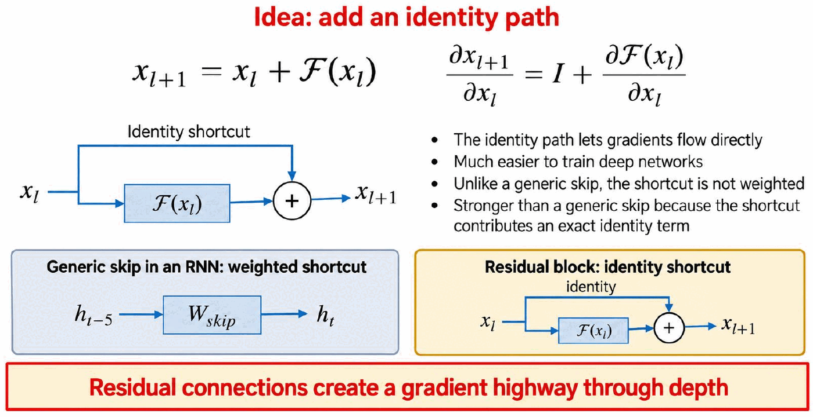
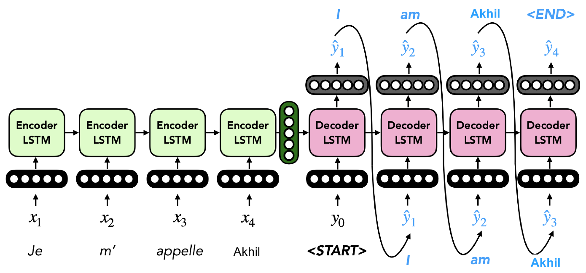
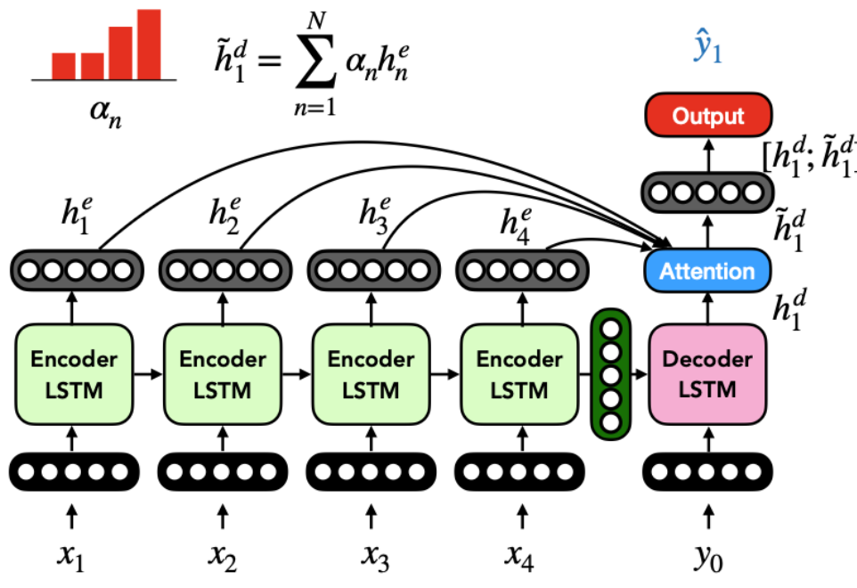
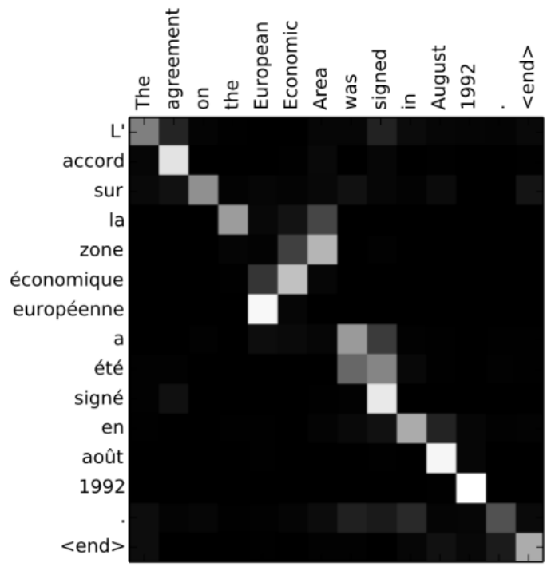
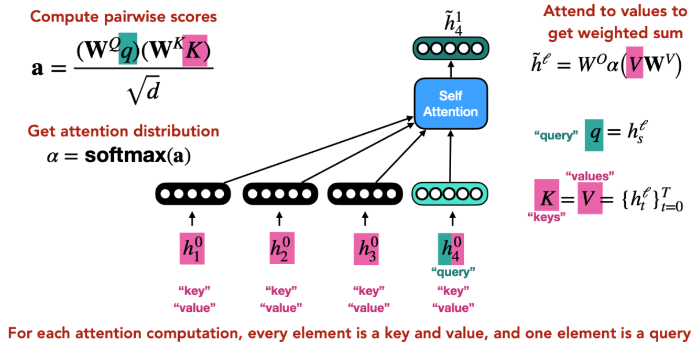
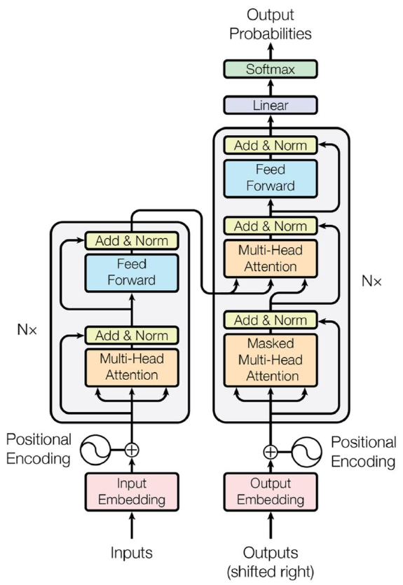

# Lecture 5 — Seq2Seq Models, Attention and Transformers

> This lecture goes from RNN encoder-decoder models, to attention, to the Transformer. Each step fixes a weakness of the one before: first the single-vector bottleneck, then the slow step-by-step encoder. Almost every modern NLP model is built on these ideas.

**After this lecture you should be able to:**
- Explain how skip connections, residual blocks and LSTM/GRU gates give gradients shorter paths.
- Describe an encoder-decoder (seq2seq) model, how it is trained, and why its decoder must be unidirectional.
- Compute attention step by step: scores, softmax weights, and the weighted sum (context vector).
- Explain self-attention with queries, keys and values, and write the scaled dot-product formula.
- Describe a Transformer block and the three attention types in the full Transformer.
- Explain why Transformers need position embeddings, and compare sinusoidal and learned ones.

---

## 1. Shorter gradient paths: skip connections and residuals

Vanishing gradients happen because the gradient is multiplied many times on its way back. The fix is always the same idea: **give gradients a shorter path**.

**Skip connections in RNNs.** Let the state also depend directly on a state several steps back (here 5 steps):

$$h_t = \sigma(W_1 h_{t-1} + W_5 h_{t-5} + W_x x_t)$$

- Backprop uses both routes. The total gradient is the gradient through the chain plus the gradient through the skip.
- The skip route has fewer multiplications, so the gradient shrinks less. This helps with longer dependencies.
- The shortcut still has its own learned weight $W_5$.

**Residual blocks.** Add an *identity* path around a function $\mathcal{F}$:

$$x_{l+1} = x_l + \mathcal{F}(x_l) \qquad \frac{\partial x_{l+1}}{\partial x_l} = I + \frac{\partial \mathcal{F}(x_l)}{\partial x_l}$$

The identity term $I$ lets gradients flow straight through. It is not weighted, so it is stronger than a generic skip. Residual connections create a **gradient highway through depth**, which makes deep networks much easier to train.

  

<em>Notice the shortcut in a residual block is a plain identity (no weight), unlike the weighted skip in an RNN.</em>

**Residual-style paths through time.** LSTMs and GRUs keep the residual idea but make it *gated*:

| Model | Update | Direct carry coefficient |
|---|---|---|
| Pure residual RNN | $h_t = h_{t-1} + F(h_{t-1}, x_t)$ | 1 (exact identity shortcut) |
| LSTM | $c_t = f_t \odot c_{t-1} + i_t \odot \tilde{c}_t$ | $f_t$ (gated) |
| GRU | $h_t = (1-z_t)\odot h_{t-1} + z_t \odot \text{func}(x_t, h_{t-1})$ | $1 - z_t$ (gated) |

If the LSTM forget gate $f_t \approx 1$ (or the GRU's $z_t \approx 0$), the old state is carried almost unchanged. The cell then behaves like a residual/skip connection through time. The difference is that the carry is learned, not fixed at 1, and gradients can also flow through the gate and candidate computations. In short: **LSTM/GRU = residual idea + learned gates**.

## 2. Encoder-decoder (seq2seq) models

What if the input sequence and the output sequence have different properties? Machine translation is the classic example.

An **encoder-decoder** model encodes the input fully with one model (the **encoder**). Its final representation seeds a second model that generates the output (the **decoder**). The decoder is **autoregressive**: like a language model, it generates one word at a time and feeds each output back in as the next input.

Running example: the encoder reads *Je m' appelle Akhil*. The decoder starts from `<START>` and produces *I am Akhil `<END>`*.

  ', each predicted word fed back as the next decoder input" width="700">

<em>The single green vector between encoder and decoder is all the decoder gets from the input, and each output word loops back as the next input.</em>

Other applications:
- **Code generation** (spec to code snippet). Warning: this is *not* how tools like Cursor or Copilot work.
- **Image captioning**: the input does not even need to be text.
- Summarization, style change/transfer, and many more.

### Bidirectional encoders
The encoder can read the input in both directions. Its representation combines a forward state $h_n^{fwd}$ and a backward state $h_n^{bwd}$. This is fine because the whole input is available up front.

The **decoder must be unidirectional**. It is autoregressive and cannot know the future words it has not generated yet.

**Does the decoder have to be twice the dimensionality of the encoder?** No. Project the concatenated encoder states down first:

$$h_0^{dec} = W_{dec}[h_n^{fwd}; h_n^{bwd}] + b_{dec}$$

### Training
Training is similar to a language model. Minimize the average cross-entropy over all output tokens, conditioned on the whole input:

$$\mathcal{L} = \sum_{t=1}^{T} -\log P(y_t \mid y_1, \ldots, y_{t-1}, x_1, \ldots, x_n)$$

- During training the decoder is fed the true previous tokens $y_0, y_1, \ldots$ as inputs.
- Gradients are backpropagated **through both the decoder and the encoder**, so both are trained jointly.
- **Practical challenge: paired data.** A language model can use any text. An encoder-decoder must learn which sequences align with which, so it needs paired data (e.g., sentences with translations, code with its comments). That is much harder to find in the wild.

## 3. The bottleneck problem

> "You can't cram the meaning of a whole %&@#&ing sentence into a single \$*(&@ing vector!" — Ray Mooney

**Toy example.** To produce "I" (which corresponds to "Je"), the model must carry "Je" through 4 extra tokens: "m'", "appelle", "Akhil" and `<START>`. A **single hidden state represents the entire input for the decoder**. This is the **temporal bottleneck**. The solution is attention.

## 4. Attention

### Attentive encoder-decoder
Each encoder time step already produces an output $h_n^e$. **Idea:** use the decoder state to compute an **attention** (a mixture) over all the encoder outputs. Intuition: focus on different parts of the input at each time step.

### The attention function, step by step
Terminology: the encoder hidden states $h_n^e$ are the **keys**. The decoder hidden state $h_t^d$ (the "idea of what to decode") is the **query**. There is one query and many keys.

1. **Scores.** Compute a pairwise similarity between the query and every key: $a_n = f(h_n^e, h_t^d)$.
2. **Weights.** Turn the scores into a probability distribution with softmax:
$$\alpha_n = \frac{e^{a_n}}{\sum_j e^{a_j}}$$
3. **Weighted sum.** Average the encoder states with these weights. Here $h_n^e$ also plays the role of the **value**:
$$\tilde{h}_t^d = \sum_{n=1}^{N} \alpha_n h_n^e$$

$\tilde{h}_t^d$ contains information from the encoder states that got high attention. It is usually concatenated with the original decoder state, $[h_t^d; \tilde{h}_t^d]$, before the output layer predicts $\hat{y}_t$. At the next time step you repeat everything and get a new distribution.

  

<em>Every encoder state connects directly to the attention block; the weights αn decide how much each contributes to the context vector.</em>

**Score functions $f$:**

| Attention function | Formula |
|---|---|
| Multiplicative (bilinear) | $a = h^e W h^d$ |
| Linear | $a = v^\top \phi(W[h^e; h^d])$ |
| Scaled dot product | $a = \dfrac{(W h^e)^\top (U h^d)}{\sqrt{d}}$ |

A plain dot product $h^e \cdot h^d$ is another option.

**Range of attention weights.** Because they come from a softmax, each $\alpha_n$ lies between 0 and 1, and they sum to 1.

### Interpretability
You can visualize the attention weights as a matrix (output words vs. input words). For an English to French translation this shows which source word was focused on for each generated word. Training with attention gives you an **implicit alignment for free**.

  

<em>Bright cells show where attention went: mostly diagonal, but note the flipped word order for "zone économique européenne".</em>

### Why attention helps
- **Fixes the temporal bottleneck:** there are direct connections between each decoder state and every encoder hidden state.
- **Helps with vanishing gradients:** those direct links are short gradient paths.
- Attention is **agnostic** to the type of RNN in the encoder and decoder.

## 5. The remaining problem: the encoder is still recurrent

The encoder still suffers from vanishing gradients over long ranges. Worse, recurrent functions **can't be parallelized**: each state needs the previous one. Encoder hidden states are still computed **in series**. This hurts for long inputs, e.g., summarization. The solution is the Transformer.

## 6. Self-attention

**Original idea:** the decoder state attends over encoder states. **New idea:** let the encoder states compute attention **over themselves**. This ditches recurrence, so all representations can be computed in parallel.

Notation: $h_t^\ell$ is the encoder hidden state at time step $t$ in layer $\ell$.

**Toy example.** To compute the new representation of $h_3^0$, it acts as the **query**, and every state $h_1^0, \ldots, h_4^0$ (including itself) acts as a **key** and a **value**. Each role gets its own learned projection $W^Q$, $W^K$, $W^V$:

$$a_{st} = \frac{(W^Q h_s^\ell)^\top (W^K h_t^\ell)}{\sqrt{d}} \qquad \alpha_{st} = \frac{e^{a_{st}}}{\sum_j e^{a_{sj}}} \qquad \tilde{h}_s^\ell = \sum_{t=1}^{T} \alpha_{st}\,(W^V h_t^\ell)$$

The sum runs over $\{1, \ldots, T\}$, which includes $s$ itself. That is what makes it *self*-attention. Dividing by $\sqrt{d}$ is the **scaled dot product**.

**Matrix form.** With query $q = h_s^\ell$ and keys = values = all states, $K = V = \{h_t^\ell\}$:

$$\mathbf{a} = \frac{(W^Q q)^\top (W^K K)}{\sqrt{d}}, \qquad \alpha = \text{softmax}(\mathbf{a}), \qquad \tilde{h}^\ell = W^O \alpha (V W^V)$$

For each attention computation, every element is a key and a value, and one element is the query. Repeat this with each position as the query. Every output is computed independently, so all of them can run in parallel.

  

<em>Here h4 is the query, but every state (including h4 itself) serves as a key and a value.</em>

### Multi-head self-attention
One attention distribution can only focus on one kind of relationship. **Multi-head** attention runs several self-attention computations ("heads" $M_1, \ldots, M_H$) in parallel, each with its own Q/K/V projections. Their outputs are combined into a single representation per word.

### Two advantages of self-attention over recurrence
1. **Parallel computation:** no state has to wait for the previous one.
2. **Direct interaction between any two positions** within one layer: short paths across the sequence for long-range dependencies.

## 7. The Transformer

### Transformer block
**Multi-head attention** is the main innovation. Each block also has:
- **Layer normalization**: normalizes outputs for stability.
- A **feed-forward network**.
- **Residual connections**: add a module's input to its output. These create shortcut paths that prevent vanishing gradients and keep crucial information from being lost.

$$x' = x + \text{Attention}(x) \qquad x'' = x' + \text{FFN}(x')$$

(each followed by "Add & Norm").

**How Transformers fight vanishing gradients.** They combine two ideas. Attention handles *sequence distance*: there is no long recurrent chain, and distant tokens connect directly. Residuals handle *network depth*: gradients flow through many layers. More generally, vanishing gradients are solved by making learning paths shorter, additive, or both.

### Full Transformer
The encoder (left) and decoder (right) are each a stack of $N$ transformer blocks, with no recurrent computation. A decoder block has three layers:
1. **Masked multi-head self-attention**
2. Multi-head attention over the final-layer encoder outputs (**cross-attention**)
3. A feed-forward network

  

<em>Follow the arrow from the encoder's top into the decoder's middle attention layer: that is cross-attention.</em>

### Masked multi-head attention
Plain self-attention lets a token attend to any token in the sequence. The decoder generates text, so tokens **must not attend to future tokens**. That would be cheating. The fix is to mask the scores of future tokens before the softmax:

$$a_{st} := a_{st} - \infty \;\; \text{for future positions} \quad\Rightarrow\quad \alpha_{st} = \frac{e^{a_{st}}}{\sum_j e^{a_{sj}}} = 0$$

### Cross-attention
Cross-attention is the classic attention from the RNN encoder-decoder. The **query** is the output of the decoder's masked self-attention (a decoder state). The **keys and values** are the outputs of the **final** encoder block. The decoder uses it to attend to the encoder outputs.

| Attention type | Where | Queries from | Keys/values from | Can see |
|---|---|---|---|---|
| Self-attention | Encoder | Encoder tokens | Same encoder tokens | Whole input |
| Masked self-attention | Decoder, layer 1 | Decoder tokens | Same decoder tokens | Only earlier positions |
| Cross-attention | Decoder, layer 2 | Decoder states | Final encoder outputs | Whole input |

### Position embeddings
Recurrent models got word order for free. **Self-attention does not**: it is a weighted sum over a set, so shuffling the words gives the same result. Transformers therefore add a **position embedding** to each input and output embedding.

- **Sinusoidal (early approach):** encode each position $i$ with sine and cosine functions, phase-shifted in proportion to the position:
$$p_i = \begin{pmatrix} \sin(i/10000^{2\cdot 1/d}) \\ \cos(i/10000^{2\cdot 1/d}) \\ \vdots \\ \sin(i/10000^{2\cdot \frac{d}{2}/d}) \\ \cos(i/10000^{2\cdot \frac{d}{2}/d}) \end{pmatrix}$$
- **Learned (common in practice):** it is easiest to learn position embeddings from scratch, as a lookup table, one vector per position.
- **Disadvantage of learned embeddings:** poor generalization to sequences longer than the maximum position you learned an embedding for.

---

## Key takeaways
- Skip connections, residuals and LSTM/GRU gates all fight vanishing gradients by giving gradients shorter or additive paths.
- Encoder-decoder models map one sequence to another. They need paired data and an autoregressive, unidirectional decoder.
- One vector for a whole sentence is a temporal bottleneck. Attention fixes it with direct links to every encoder state.
- Attention = scores, then softmax weights (between 0 and 1, summing to 1), then a weighted sum of values.
- Recurrent encoders run in series. Self-attention removes recurrence so every position is computed in parallel.
- Scaled dot-product self-attention uses queries, keys and values: $\text{softmax}\big((W^Q q)^\top (W^K K)/\sqrt{d}\big)$ applied to the projected values.
- A Transformer block = multi-head attention + feed-forward, each with a residual connection and layer norm.
- The decoder uses masked self-attention and cross-attention. Position embeddings supply the word order that self-attention lacks.

## Check yourself

Does the decoder have to be twice the dimensionality of a bidirectional encoder?

No. Project the concatenated forward and backward states first: $h_0^{dec} = W_{dec}[h_n^{fwd}; h_n^{bwd}] + b_{dec}$.

How can we mitigate the temporal bottleneck in seq2seq models?

With attention. At each step the decoder computes a weighted sum over *all* encoder hidden states, so it has direct connections to the input instead of relying on one final vector.

In what range can an attention weight fall?

Between 0 and 1. The weights come from a softmax, so they are non-negative and sum to 1.

Do any other inefficiencies remain in an attentive RNN seq2seq pipeline?

Yes. The encoder is still recurrent, so its hidden states must be computed in series and can't be parallelized. This is a problem for long inputs such as summarization.

What are the two advantages of self-attention over recurrent models?

All positions can be computed in parallel, and any two positions interact directly in one layer. That gives short paths for long-range dependencies.

What is an issue with self-attention for the decoder, and what is a disadvantage of learned position embeddings?

Plain self-attention would let the decoder see future tokens, so future scores are masked to $-\infty$, which gives them attention 0. Learned position embeddings generalize poorly to sequences longer than the maximum position seen in training.

---
📚 Want to go deeper? See the **Lecture 5** section of [Further Reading](Further-Reading.md#5--seq2seq-attention-and-transformers).
