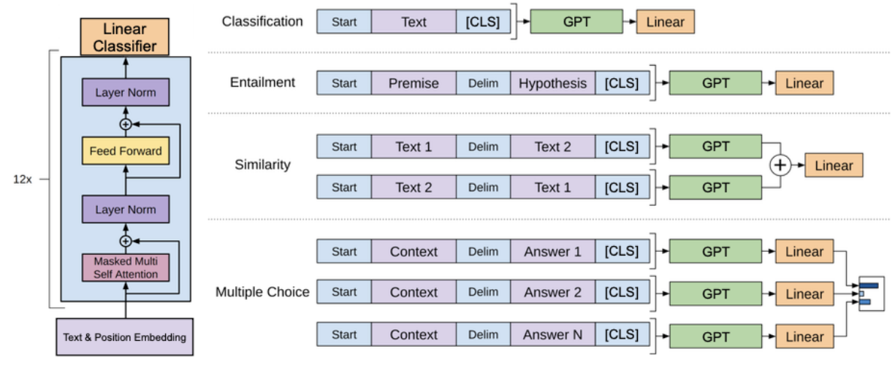
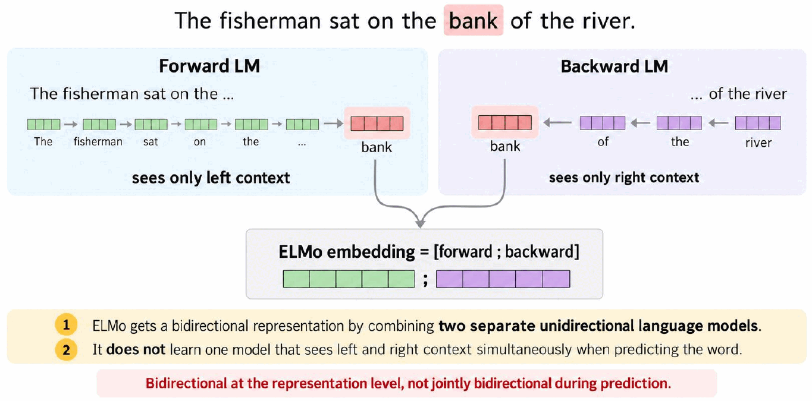
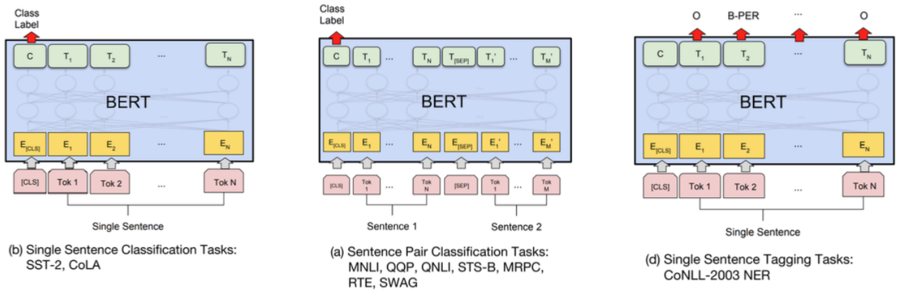
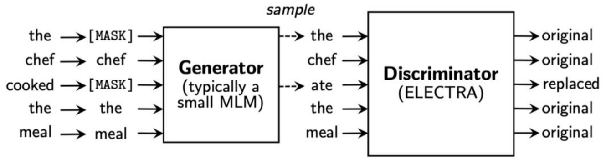
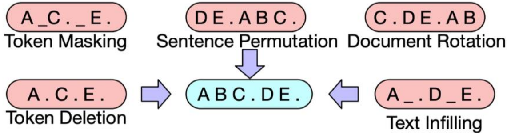
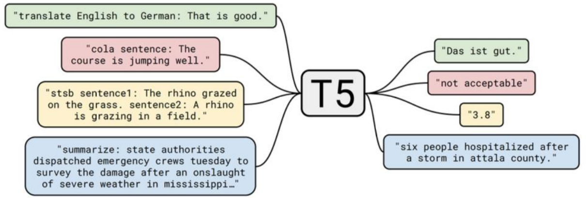

# Lecture 6 — Pre-trained Language Models: GPT, BERT, BART and T5

> This lecture shows how Transformers became *pretrained* models: train once on huge amounts of raw text, then fine-tune for many tasks. You meet the three families that shaped modern NLP: decoders (GPT), encoders (ELMo's successor BERT), and encoder-decoders (BART, T5).

**After this lecture you should be able to:**
- Explain the GPT architecture and its causal language modelling objective, and how GPT is fine-tuned for tasks like entailment and similarity.
- Explain why static word embeddings fall short and how ELMo builds contextual embeddings from a biLSTM.
- Describe BERT's masked language modelling (the 15% rule and the 80/10/10 split) and how BERT is fine-tuned with the [CLS] token.
- Compare fine-tuning a whole model with using its frozen embeddings (feature-based transfer).
- Explain how BART and T5 pretrain sequence-to-sequence models with corrupted inputs, and why they can generate text.
- Pick the right family (GPT, BERT, BART/T5) for a given task.

---

## 1. A bridge: the cost of Transformers

**Time complexity:** self-attention compares every token with every other token, so it is **quadratic** in sequence length. An RNN processes one token at a time, which is **linear**. Long inputs are therefore expensive for Transformers. Sparse attention patterns (global, local and random attention combined, as in BigBird) are one way to reduce this cost.

## 2. GPT: Generative Pretrained Transformer

**Architecture.** GPT is called a **decoder transformer**, but its block mixes ideas from both halves of the original Transformer:
- It uses **masked multi-headed self-attention** (like the decoder): the token at each step cannot attend to future tokens.
- It has **no cross-attention**; it only computes self-attention over its own history (like the encoder).
- One block = masked multi-head self-attention, layer norm, feed-forward, layer norm, with residual connections. GPT stacks 12 blocks on top of text and position embeddings.

**Training data.** GPT was pretrained on the Toronto BooksCorpus: 7000 unpublished books (~13 GB). The corpus is split into **windows of 512 tokens**, so GPT can model context up to 512 tokens.

**Pretraining objective: causal language modelling** (next-word prediction). Minimise the negative log probability of the gold sequences in your dataset:

```math
\mathcal{L} = -\sum_{t=1}^{T} \log P\big(x_t^{\ast} \mid \{x_s^{\ast}\}_{s\lt t}\big)
```

The input is `[START]` $`x_1^{\ast} \dots x_T^{\ast}`$ and the targets are the same tokens shifted by one, ending with `[END]`.

## 3. Pretraining, then fine-tuning

After pretraining, you use the pretrained model as the **initialisation** for training on individual task datasets. This is **fine-tuning**. You add a linear layer on top and minimise the cross-entropy of the gold label:

```math
\mathcal{L} = -\log P(y^{\ast} \mid X)
```

The input ends with a special `[CLS]` token; its final representation goes through a **linear projection (linear classifier)** to give $`P(y^{\ast} \mid X)`$.

Different tasks are handled by **formatting the input** as a token sequence, not by changing the architecture:

| Task | Input format |
|---|---|
| Classification | `Start` Text `[CLS]` → GPT → Linear |
| Entailment | `Start` Premise `Delim` Hypothesis `[CLS]` → GPT → Linear |
| Similarity | Both orders (Text 1, Text 2) and (Text 2, Text 1) through GPT; outputs added → Linear |
| Multiple choice | `Start` Context `Delim` Answer *i* `[CLS]` for each answer; scores compared |

<p align="center">
  
</p>
<p align="center"><em>The same GPT handles every task; only the way the input sequence is built (Start, Delim, [CLS]) changes.</em></p>

Examples from class:
- **Entailment (NLI):** Premise "Akhil was giving a lecture." Hypothesis "The students were learning." → Entailed, contradicted or neutral?
- **Similarity:** "Akhil was giving a lecture." vs "Akhil was teaching." → Similar or not?

**The paradigm shift.** Before: train a task-specific architecture (e.g., an LSTM or GRU) initialised with pretrained word embeddings (word2vec, GloVe, fastText). After: **fine-tune the whole pretrained model.**

## 4. GPT-2 and the increase in scale

**GPT-2** has roughly the same architecture as GPT but was trained on **40 GB** of data (**OpenWebText**: articles linked to/from Reddit threads). It came in four sizes:

| Parameters | Layers | $`d_{model}`$ |
|---|---|---|
| 117M | 12 | 768 |
| 345M | 24 | 1024 |
| 762M | 36 | 1280 |
| 1542M | 48 | 1600 |

GPT-2 put **less focus on fine-tuning and more on zero-shot prediction**: it set new records on many language modelling benchmarks without task-specific training, and could write long, fluent continuations of a prompt.

**Scale over time:**
- GPT (Jun 2018): 117 million parameters, 13 GB of data (~1 billion tokens)
- GPT-2 (Feb 2019): 1.5 billion parameters, 40 GB of data
- GPT-3 (Jul 2020): 175 billion parameters, ~500 GB of data (~300 billion tokens)
- GPT-4 (Mar 2023): 1.8T parameters (rumoured), data unknown

More on this in Weeks 7 and 13.

## 5. Static vs contextual embeddings: ELMo

GPT was **not** the first large-scale pretrained neural representation. Word embeddings such as **word2vec** came first.

**The issue with word embeddings:** words have different meanings in different contexts, but **static** word embeddings learn one fixed vector per word. "bank" gets the same vector in "I deposited money in the bank" and "I sat on the bank of the river".

**ELMo (Embeddings from Language Models, 2018)** fixes this with bidirectional LSTMs:
- Train a **two-layer LSTM language model** on a large corpus.
- The LSTMs are **bidirectional**: a forward LM and a backward LM. Training maximises

```math
\sum_{k=1}^{N}\Big(\log p(t_k \mid t_1,\dots,t_{k-1}) + \log p(t_k \mid t_{k+1},\dots,t_N)\Big)
```

- Use the **hidden states** of each token as its embedding. These depend on the surrounding words, so "bank" gets $`v_1 \neq v_2`$ in the two sentences.
- It was trained on the 1B Word Benchmark, which contains **single sentences**, so it cannot learn context across sentences.

**Using ELMo in a task.** Combine all layers with task-specific weights:

```math
\text{ELMo}_k^{task} = \gamma^{task} \sum_{j=0}^{L} s_j^{task}\, \mathbf{h}_{k,j}^{LM}
```

- $`\mathbf{h}_{k,0}^{LM}`$ (layer 0) is just the word embedding; higher layers are concatenations of the biLSTM hidden states.
- $`s_j^{task}`$: softmax-normalised weights across layers. $`\gamma^{task}`$: scales the whole ELMo vector. Both are learned.
- **Why not just use the final layer?** For different tasks, useful representations are at different layers. Lower layers capture more local/syntactic cues (useful for POS tagging); higher layers capture more abstract/semantic cues (useful for semantic inference).

**ELMo's issue:** it is a **unidirectional model masquerading as bidirectional**. A separate forward LM sees only the left context and a separate backward LM sees only the right context; their representations are concatenated. No single model sees both sides at once when predicting a word.

<p align="center">
  
</p>
<p align="center"><em>Each LM sees only one side of "bank"; ELMo just concatenates the two, so it is bidirectional only at the representation level.</em></p>

## 6. BERT: Bidirectional Encoder Representations from Transformers

**Data and size.** BERT (Oct 2018) was trained on Toronto BooksCorpus (800 million tokens) and English Wikipedia (2.5 billion tokens): ~3.3 billion tokens from ~13 GB of data.

**Architecture:** a Transformer **encoder**.
- BERT-Base: 12 layers, $`d=768`$, 12 heads, 110M parameters
- BERT-Large: 24 layers, $`d=1024`$, 16 heads, 340M parameters

**Two pretraining approaches:**
- **Causal (left-to-right) LM** (GPT): "I really enjoyed the movie we watched on ____"
- **Masked LM** (BERT): "I really enjoyed the ____ we watched on Saturday!" The model sees both sides.

**Masked language modelling.** Pretraining is self-supervised, on any large raw text corpus. Pick **15% of the tokens** to predict. For those tokens:
- 80%: replace with `[MASK]` ("Akhil taught **[MASK]** today")
- 10%: replace with a random token ("Akhil taught **chocolate** today")
- 10%: keep the original token ("Akhil taught **class** today")

The model must predict the original word ("class") in every case.

BERT also uses a **next sentence prediction (NSP)** task during pretraining; the ablations below test removing it.

**Fine-tuning for classification.** After pretraining (no more pretraining objectives), you update all BERT parameters on the task:
- Prepend a special `[CLS]` token to the input.
- BERT outputs a contextual embedding for every token.
- Classify the `[CLS]` output embedding with a **linear classifier**.

**Why is [CLS] at the front?** It is the easiest place to put it, and because BERT is bidirectional, `[CLS]` attends to the representations of all other tokens anyway.

**One model, many tasks.** The same pretrained BERT is the starting point for:
- **Classification** (single sentence, e.g., SST-2, CoLA; or sentence pairs, e.g., MNLI, QQP): use the `[CLS]` output.
- **Sequence labelling** (e.g., NER): classify the output embedding of each token.

<p align="center">
  
</p>
<p align="center"><em>Classification reads the label off the [CLS] output (C); tagging predicts a label from every token's output.</em></p>

## 7. BERT's results and what it learns

**GLUE** is the prototypical natural language understanding benchmark: single-sentence tasks (CoLA, SST-2), similarity/paraphrase tasks (MRPC, STS-B, QQP) and inference tasks (MNLI, QNLI, RTE, WNLI).

- BERT improved performance across the board: average 79.6 (Base) and 81.9 (Large) vs 75.2 for OpenAI GPT.
- The big gain over GPT highlights the **importance of bidirectionality**.
- Note: a **different BERT model is fine-tuned for each task**. It is not one fine-tuned model doing everything.

**Ablations:**
- Training left-to-right only (LTR, like GPT) and removing NSP hurts performance: **bidirectionality matters**.
- Bigger models (more layers, larger hidden size, more heads) do better: **more parameters = better**.

**Fine-tuning vs embeddings.** You can freeze BERT and feed its embeddings to a different model (the feature-based approach, like ELMo). BERT works, but it performs better when **fully fine-tuned**.

**Transfer learning** in summary:
- **Pretraining** learns embeddings to seed a downstream model (ELMo) or a model to fine-tune (GPT, BERT). It uses simple objectives and tons of data, is slow and expensive (often done only once), and the result is often not useful on its own yet.
- **Fine-tuning** either trains a new architecture initialised with pretrained embeddings, or trains the pretrained model further on task data. It uses smaller datasets with more complex structure, and is typically cheaper: you can afford multiple runs and hyperparameter tuning.

**What does BERT learn?** Its attention heads learn diverse patterns that map to **positional** relationships (e.g., attend to the next token), **syntactic** and **semantic** relationships, and some attend broadly or to special tokens like `[SEP]` and periods.

**What to mask? Whole-word masking.** Words are split into subwords: "Obama" → `_O` `bama`. Masking only `_O` leaves `_bama` visible, making the prediction too easy, so the model doesn't learn as well. **Whole-word masking** masks all subwords of a word: `[MASK] [MASK] _was _the _president ...`.

## 8. Improving BERT: RoBERTa, DistilBERT, ELECTRA

- **RoBERTa** ("Robustly Optimised BERT"): same architecture, but a collection of training improvements, mainly **160 GB of data instead of 13 GB** and longer pretraining. It beats BERT-Large on SQuAD, MNLI and SST-2.
- **DistilBERT:** BERT has many parameters, which need lots of storage. Train a smaller model by **distillation** over BERT's soft target probabilities, plus MLM:

```math
\mathcal{L}_{distil} = -P_{BERT}\big(y_t^{\ast} \mid [\text{M}], \{y_s^{\ast}\}_{s\neq t}\big)\,\log P_{dbert}\big(y_t^{\ast} \mid [\text{M}], \{y_s^{\ast}\}_{s\neq t}\big)
```

```math
\mathcal{L}_{mlm} = -\log P_{dbert}\big(y_t^{\ast} \mid [\text{M}], \{y_s^{\ast}\}_{s\neq t}\big) \qquad \mathcal{L}_{tot} = \gamma_1\mathcal{L}_{distil} + \gamma_2\mathcal{L}_{mlm}
```

The much smaller DistilBERT keeps ~97% of BERT's performance.
- **ELECTRA:** BERT only learns from the 15% masked tokens, which is inefficient. ELECTRA uses a small MLM **generator** to fill in masked tokens ("the chef **ate** the meal" instead of "cooked"), and a **discriminator** (ELECTRA) that predicts for **every** token whether it is *original* or *replaced*. Learning from all tokens drastically speeds up training: it reaches a given GLUE score with far fewer pretraining FLOPs.

<p align="center">
  
</p>
<p align="center"><em>The generator swaps "cooked" for "ate"; the discriminator gets a training signal from every token, not just the masked 15%.</em></p>

## 9. BART: Bidirectional and Autoregressive Transformer

**Data and architecture.** BART (Oct 2019) was trained on BooksCorpus and many more books, plus English Wikipedia. It is the **classic Transformer**: a **bidirectional encoder** feeds an **autoregressive decoder**, and **cross-attention is back**.
- BART-Base: 6 encoder + 6 decoder layers, 140M parameters
- BART-Large: 12 + 12 layers, 400M parameters

**Pretraining** combines BERT and GPT:
- **BERT-style:** the input text is corrupted before it enters the bidirectional encoder.
- **GPT-style:** the decoder is trained with a language modelling objective (predict the next word) to reconstruct the original text.

Because the decoder regenerates the whole text, you can corrupt the input in many ways (original `ABC.DE.`):
- **Token masking:** `A_C._E.`
- **Token deletion:** `A.C.E.`
- **Text infilling:** `A_.D_E.` (a span replaced by one mask)
- **Sentence permutation:** `DE.ABC.`
- **Document rotation:** `C.DE.AB`

<p align="center">
  
</p>
<p align="center"><em>Whatever the corruption, the decoder's target is always the original text ABC.DE.</em></p>

Different corruptions transfer better to different tasks. The chosen recipe is **text infilling + sentence permutation**.

**BART vs BERT.**
- BART can do everything BERT does. For classification, feed the input to both encoder and decoder, append `[CLS]` to the decoder sequence and classify its output. For sequence labelling, classify the decoder output for each token.
- It is almost as good as RoBERTa and much better than BERT, because it was **trained on far more data**.
- BART can also do **generation** tasks (e.g., summarisation), because it has an **autoregressive decoder**.

## 10. T5

**Text-to-text framing.** Like BART, T5 casts every problem as sequence-to-sequence. A task prefix tells the model what to do:
- "translate English to German: That is good." → "Das ist gut."
- "cola sentence: The course is jumping well." → "not acceptable"
- "stsb sentence1: The rhino grazed on the grass. sentence2: A rhino is grazing in a field." → "3.8"

<p align="center">
  
</p>
<p align="center"><em>One model, one format: even a classification label or a similarity score comes out as text.</em></p>

**Pretraining objective: span infilling.** Spans are replaced by sentinel tokens and the model reconstructs them:
- Original: "Thank you for inviting me to your party last week."
- Input: "Thank you `<X>` me to your party `<Y>` week."
- Target: "`<X>` for inviting `<Y>` last `<Z>`"

**Pretraining decisions.** T5 systematically explored many dimensions of pretraining in the seq2seq framework: high-level approach (language modelling, BERT-style, deshuffling), corruption strategy (mask, replace spans, drop), corruption rate (10–50%) and corrupted span length (2–10). The findings were used to train a much larger model with **11B parameters**.

---

## Key takeaways
- Transformers are quadratic in sequence length; RNNs are linear.
- GPT = Transformer decoder (masked self-attention, no cross-attention) pretrained with causal LM; good for generating text.
- The paradigm shifted from "pretrained embeddings + task architecture" to "fine-tune the whole pretrained model".
- Static embeddings give one vector per word; ELMo gives context-dependent vectors but is only two concatenated unidirectional LMs.
- BERT = Transformer encoder pretrained with masked LM (15%, 80/10/10); good for classification and sequence labelling via `[CLS]` or per-token outputs.
- Bidirectionality and scale both drive BERT's gains; full fine-tuning beats frozen embeddings.
- RoBERTa (more data), DistilBERT (distillation, smaller) and ELECTRA (replaced token detection on all tokens) improve on BERT.
- BART and T5 pretrain encoder-decoders by reconstructing corrupted text, so they handle all task types, including generation.

## Check yourself
<details>
<summary>What could be a disadvantage of Transformers over RNNs?</summary>

Time complexity: self-attention is quadratic in sequence length, while an RNN is linear.
</details>

<details>
<summary>What's an issue with word embeddings like word2vec?</summary>

Words have different meanings in different contexts, but static embeddings learn one fixed vector per word.
</details>

<details>
<summary>Why does ELMo combine all layers with learned weights instead of using the final layer?</summary>

Different tasks need different information: lower layers hold more local/syntactic cues, higher layers more semantic cues. Each task learns its own weights $`s_j^{task}`$.
</details>

<details>
<summary>What's an issue with ELMo?</summary>

It is unidirectional models masquerading as bidirectional: a separate forward and backward LM are concatenated, so no single model sees left and right context at once.
</details>

<details>
<summary>Why do we put the [CLS] token at the front of the sequence?</summary>

It is the easiest place to put it, and bidirectionality ensures it attends to the representations of all other tokens.
</details>

<details>
<summary>Why might whole-word masking be important?</summary>

If only one subword is masked, it is too easy to predict from the rest of the word in context, so the model doesn't learn as well.
</details>

---
📚 Want to go deeper? See the **Lecture 6** section of [Further Reading](Further-Reading.md#6--pre-trained-language-models).
