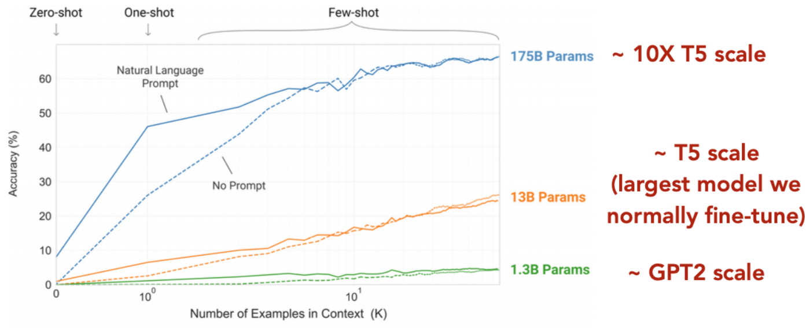
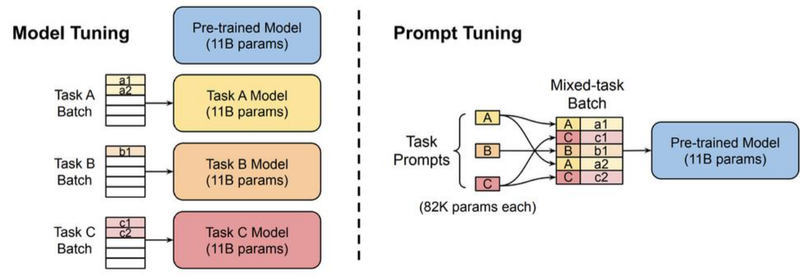
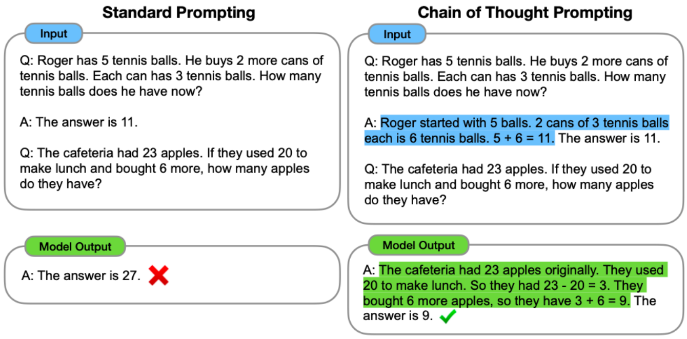
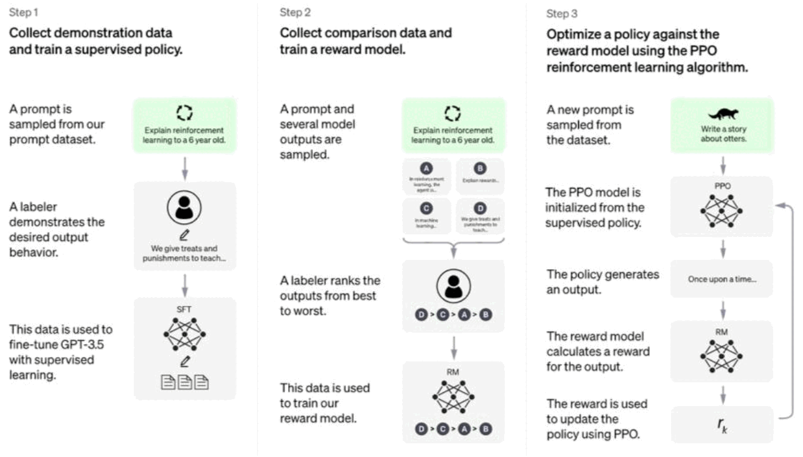
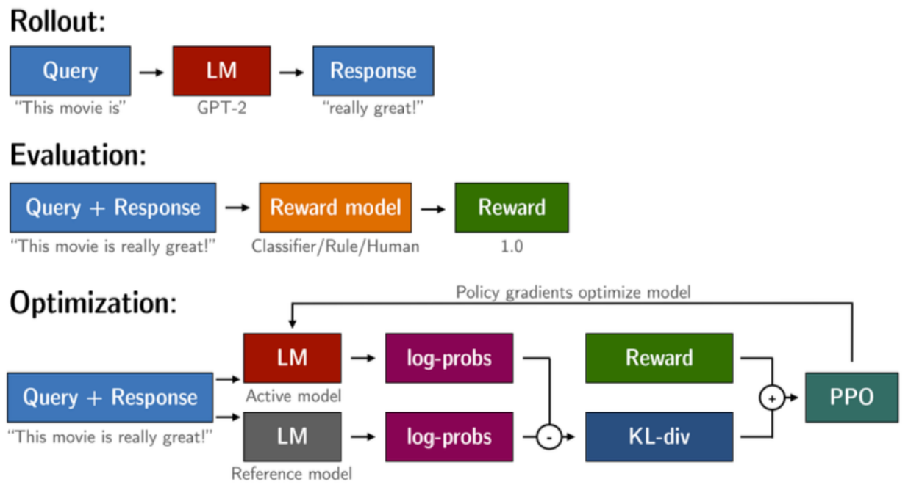
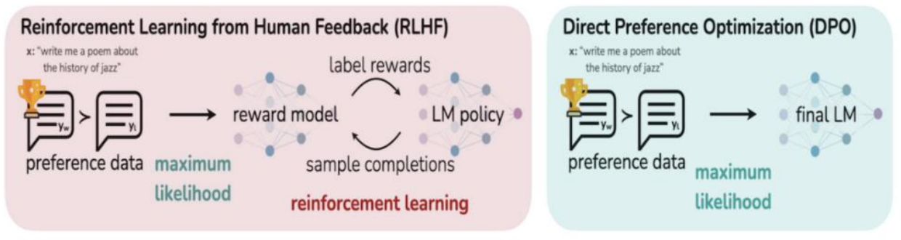

# Lecture 7 — Large Language Models: In-Context Learning, Prompting and RLHF

> When language models are scaled up far enough, new abilities appear: they can do tasks from a prompt alone, with no gradient updates. This lecture covers how to use those abilities (in-context learning, prompting, prompt tuning, chain-of-thought) and how GPT-3 was turned into an instruction-following assistant like ChatGPT (SFT, reward models, RLHF with REINFORCE/PPO, and DPO).

**After this lecture you should be able to:**
- Describe how model size, data and compute have grown, and define "emergence" for LLMs
- Compare fine-tuning, zero-shot, few-shot in-context learning and prompt tuning: what gets updated and what data is needed
- Explain why in-context learning is sensitive and how prompt engineering, prompt tuning and chain-of-thought improve it
- Walk through the three steps from GPT-3 to ChatGPT: SFT, reward model training, RL optimisation
- Write down and interpret the reward model loss, the REINFORCE loss (with baseline) and the PPO and DPO objectives

---

## 1. Scaling LMs into LLMs

Model sizes have grown fast:

| Model | Released | Parameters | Data |
|---|---|---|---|
| GPT | Jun 2018 | 117M | 13GB (~1B tokens) |
| GPT-2 | Feb 2019 | 1.5B | 40GB |
| GPT-3 | Jul 2020 | 175B | ~500GB (~300B tokens) |
| GPT-4 | Mar 2023 | 1.8T (rumored) | unknown |

Training compute (petaflop/s-days, **log scale**) climbs from BERT to T5-11B to GPT-3 175B. Model size over time (ELMo 94M → GPT-2 1.5B → GPT-3 175B → Megatron-Turing NLG 530B) is roughly a straight line on a log axis: exponential growth.

Scaling means **larger models, more data, more compute, and more money**. Training costs are doubling every nine months.

## 2. Emergence

What happens when we train at this very large scale?

- Philip Anderson (1972): "Emergence is when quantitative changes in a system result in qualitative changes in behavior."
- For LLMs: "an ability is **emergent** if it is not present in smaller models but is present in larger models."

This is a **controversial topic**.

## 3. From old paradigms to in-context learning

The running example is English → French translation (`sea otter => loutre de mer`, `peppermint => menthe poivrée`, `plush girafe => girafe peluche`, then `cheese =>`).

**Old paradigm 1: fine-tuning (GPT, BERT).** You give the model training examples, compute the loss on its predictions, compute gradients w.r.t. *all* parameters, and update them. Then you test on new examples. The model learns by **updating its parameters**.

**Old paradigm 2: zero-shot (GPT-2).** You use the pretrained model as-is. You give a **task description** ("Translate English to French:") and a **prompt** ("cheese =>"). No gradient updates.

**New paradigm: in-context learning (ICL).** You concatenate, in the *same* input sequence:
1. a task description (as in zero-shot),
2. one or more examples of the task (context + label),
3. the final prompt you want a label for.

With zero examples this is **zero-shot**, with one it is **one-shot**, with a few it is **few-shot**. No gradient updates are performed. The model "learns" only by attending to the tokens of the in-context examples. There is no more learning in the classical sense.

## 4. Results and the necessity of scale

**TriviaQA** (e.g. "Miami Beach in Florida borders which ocean?"). GPT-3 has no access to supporting documents, so this is pure memorisation. Accuracy rises with size, few-shot > one-shot > zero-shot, and few-shot (K=64) GPT-3 175B reaches the fine-tuned state of the art.

**Machine translation.** GPT-3 was not explicitly trained to translate and not purposefully trained on multilingual data (though about 7% of its data is not English). It still learns some translation ability, improving with scale. Few-shot GPT-3 is competitive with supervised systems in some directions (e.g. Fr→En 39.2, De→En 40.6 BLEU), but it is **much better at translating into English** than out of English (e.g. En→Ro only 21.0).

**Scale is necessary.** Plotting accuracy against the number of in-context examples K:
- 1.3B (~GPT-2 scale): barely improves.
- 13B (~T5 scale, the largest model we normally fine-tune): modest gains.
- 175B (~10× T5): large gains, and a natural-language prompt helps a lot at small K.

  

<em>Only the 175B curve climbs steeply with more examples; the 1.3B model stays near zero whatever K is.</em>

In-context learning only works well with **very large** models.

## 5. In-context learning is sensitive

- **Example selection matters.** GPT-3 on SST-2 sentiment with five different random sets of in-context examples gave accuracies from 86.9 to 95.8.
- **Example order matters.** Across 24 random orderings of the same examples, performance varies a lot, especially for smaller models.

## 6. Why does in-context learning work?

There is **no clear, unifying theory yet**. Generally, terms that are **more frequently mentioned in pretraining corpora** are easier for models to handle in context (e.g. arithmetic accuracy tracks how often the numbers appear in pretraining data).

## 7. Making ICL more effective: prompt engineering

**Prompt engineering** means choosing how you phrase the task. For Yelp reviews (predict a 1–5 star rating for review text $a$):

- **Patterns** express the task, e.g. $P_1(a) =$ "It was \_\_\_. $a$", $P_3(a) =$ "$a$. All in all, it was \_\_\_.", $P_4(a) =$ "$a$ ‖ In summary, the restaurant is \_\_\_."
- A **verbalizer** maps labels to words: $v(1)=$ terrible, $v(2)=$ bad, $v(3)=$ okay, $v(4)=$ good, $v(5)=$ great.

You select the patterns and verbalizers that make the model best at the task. Good prompts can sometimes improve performance even at small scale.

### What makes the best prompt?

**AutoPrompt** searches for the best prompt automatically. It uses **gradient-guided search**: initialise a set of trigger tokens $[T]$ in a template like `{sentence}[T][T][T][P]`, then estimate how the loss would change if each trigger token were replaced by another vocabulary token, and swap in the best ones.

The prompts it finds are often **sequences of random-looking words** (e.g. "a real joy. atmosphere alot dialogue Clone totally [MASK]"). Such odd token strings are the foundation of **"jailbreaking"**.

## 8. Learning the prompt: soft prompts / prompt tuning

If the optimal discrete prompt is random tokens anyway, why not **learn the prompt** directly as vectors?

**Prompt tuning**, for each task:
1. Initialise one or more special input **prompt vectors**.
2. Prepend them to every example of the task.
3. Compute gradients of the loss w.r.t. the prompt parameters.
4. Update **only the prompt vectors**. The rest of the model is frozen.

Model tuning needs a separate 11B-parameter copy per task. Prompt tuning keeps one frozen 11B model plus a small prompt per task (about 82K parameters), and tasks can be mixed in one batch.

  

<em>Model tuning copies the whole 11B model per task; prompt tuning shares one frozen model and only swaps a tiny prompt per example.</em>

**Advantages and disadvantages** (the in-class poll):
- (+) More efficient training, and separable multi-task learning.
- (−) Not as interpretable as discrete prompts.

**Scale results (SuperGLUE):** as model size grows,
- prompt tuning becomes competitive with full model fine-tuning (and far beats manual prompt design),
- the length of the prompt matters less,
- the initialisation of the prompt no longer matters.

You need large models for these benefits to emerge.

| Method | What is updated | Data needed |
|---|---|---|
| Fine-tuning | All model parameters | Labelled training set |
| Zero-shot | Nothing | Task description only |
| In-context (few-shot) | Nothing | A few examples in the prompt |
| Prompt tuning | Only the soft prompt vectors | Labelled training set |

## 9. Chain-of-thought prompting

Another ability that appears at scale. In-class example:

> Q: Roger has 5 tennis balls. He buys 2 more cans of tennis balls. Each can has 3 tennis balls. How many tennis balls does he have now?

- **Standard prompting** shows only "A: The answer is 11." For the cafeteria question (23 apples, use 20, buy 6 more) the model answers 27. Wrong.
- **Chain-of-thought prompting** shows the reasoning in the example: "Roger started with 5 balls. 2 cans of 3 tennis balls each is 6 tennis balls. 5 + 6 = 11." The model then reasons too: "23 − 20 = 3 … 3 + 6 = 9. The answer is 9." Correct.

  

<em>The only difference is the highlighted reasoning in the example answer, and the model copies that style to get the right result.</em>

For complex problems, demonstrate the reasoning, not just the answer; the model learns to produce an explanation as it decodes. On math word problems (GSM8K, SVAMP, MAWPS), CoT helps only for the largest LaMDA, GPT and PaLM models. **You need scale for chain-of-thought to work.**

## 10. Wrap-up of prompting

ICL can be improved by manual prompt design, mining/paraphrasing prompts, gradient-based prompt search, LM-generated prompts and soft prompts. These work because models are much bigger, and because **every task can be mapped to a natural-language description**: predicting a label just means producing the word mapped to it. Guiding a model with natural language is exactly what ChatGPT does.

## 11. From GPT-3 to ChatGPT

Three steps:
1. Collect demonstration data and train a supervised policy (**SFT**).
2. Collect comparison data and train a **reward model**.
3. Optimise the policy against the reward model with **RL (PPO)**.

  

<em>Each step feeds the next: the SFT model initialises PPO, and the reward model trained on rankings supplies the reward in step 3.</em>

Humans write a **demonstration** of the task requested by each instruction. About 75k demonstrations were collected: 13k for SFT, 31k for the reward model, 33k for PPO (RLHF).

### Step 1: Supervised fine-tuning (SFT)

Train the model to generate the next word $y_t^*$ of the demonstration given the earlier demonstration words and the instruction $x^*$:

$$\mathcal{L} = -\sum_{t=1}^{T} \log P\left(y_t^* \mid \{y^*\}_{<t};\ \{x^*\}\right)$$

**Shortcomings of only using SFT:**
- **Expensive** to collect lots of demonstration data.
- **Exposure bias**: in training the model sees gold human-written context tokens, but at generation time it sees its own previously decoded tokens. Errors can compound (in class: a generated text repeating "Universidad Nacional Autónoma de México" over and over).

### Step 2: Train a reward model

We cannot get human judgments for every output, so we train a **reward model** to predict a quality score for any demonstration given the instruction. Humans rank several model outputs. For a pair where $Y_+$ is better than $Y_-$:

$$\mathcal{L}_{RM} = -\log \sigma\big(R(Y_+) - R(Y_-)\big)$$

As $R(Y_+) - R(Y_-) \to \infty$, $\sigma(\cdot) \to 1$ and the loss $\to 0$. So the model learns to score good demonstrations higher. Now any demonstration $Y$ gets a score $R(Y)$.

### Step 3: Optimise with RL

Loop: sample a response to a query, score it with the reward model, update the LM with policy gradients. In the PPO setup, the active model's log-probabilities are also compared with a frozen **reference model** through a **KL-divergence** term combined with the reward.

  

<em>The KL term between the active and frozen reference model keeps the policy from drifting too far while it chases reward.</em>

**REINFORCE.** Given an instruction, sample a demonstration $\hat{Y}$ from the model and minimise

$$\mathcal{L}_{RL} = -R(\hat{Y}) \sum_{t=1}^{T} \log P\left(\hat{y}_t \mid \{x^*\};\ \{\hat{y}\}_{<t}\right)$$

Read it as: next time, increase the probability of this sampled token in this context, and do it more if the reward is high.

**Implementation tricks:**
- **Start from the SFT model.**
- **Subtract a baseline** $b$:
$$\mathcal{L}_{RL} = -\big(R(\hat{Y}) - b\big) \sum_{t=1}^{T} \log P\left(\hat{y}_t \mid \{x^*\};\ \{\hat{y}\}_{<t}\right)$$
  Why? If $R(\hat{Y}) > 0$ always, every sampled generation has its probability pushed up, so you **never penalise a generation**. With a baseline, below-average outputs get a negative weight and are pushed down.
- **Keep encouraging coherence** by mixing in the MLE loss: $\mathcal{L} = \mathcal{L}_{MLE} + \alpha\,\mathcal{L}_{RL}$.

**PPO.** Instead of raw log-probabilities, PPO uses the log-ratio between the current policy and the base policy, and takes a minimum with a clipped term:

$$\mathcal{L}_{PPO} = -\min\left( R(\hat{Y}) \sum_{t=1}^{T} \log \frac{P_{curr}(\hat{y}_t \mid \{x^*\}; \{\hat{y}\}_{<t})}{P_{base}(\hat{y}_t \mid \{x^*\}; \{\hat{y}\}_{<t})},\ g(\epsilon, R(\hat{Y})) \right)$$

$$g(\epsilon, R(\hat{Y})) = \begin{cases} (1+\epsilon)\,R(\hat{Y}) & \text{if } R(\hat{Y}) \ge 0 \\ (1-\epsilon)\,R(\hat{Y}) & \text{if } R(\hat{Y}) < 0 \end{cases}$$

How it differs from REINFORCE:
- The ratio term takes **extreme values when $P_{curr}$ and $P_{base}$ deviate**.
- The **min** limits how far the policy can move from the base policy in each step. For example, if the reward is positive, the objective is capped at $(1+\epsilon)R(\hat{Y})$.

### Outcomes

- **Improvement:** in win rate against SFT 175B, PPO-trained models beat SFT, prompted GPT-3 and plain GPT-3 at every size. **Instruction-tuned smaller models (even 1.3B) are better at human tasks than GPT-3 175B.**
- **Multi-task abilities:** one model plans a constrained Paris itinerary and writes Python code for attention.
- **Personalization:** "Explain the causes of World War I" gets a complex essay or a 10-year-old's version, depending on the instruction.

## 12. Direct Preference Optimization (DPO)

In RLHF a reward model learns human preferences, then RL optimises the LM against it. **DPO** skips the reward model and the RL loop: it optimises for human preferences **directly** from preference data with a maximum-likelihood-style loss:

$$\mathcal{L}_{DPO} = -\log \sigma\left( \beta \log \frac{P_{curr}(Y_+ \mid x^*)}{P_{base}(Y_+ \mid x^*)} - \beta \log \frac{P_{curr}(Y_- \mid x^*)}{P_{base}(Y_- \mid x^*)} \right)$$

The objective pushes the ratio $P_{curr}/P_{base}$ to be higher for the preferred sample $Y_+$ than for $Y_-$. Compare it with $\mathcal{L}_{RM}$: the scaled log-ratio plays the role of the reward. DPO is **less flexible than RLHF in theory, but works well in practice**.

  

<em>DPO removes the reward model and the sampling loop: preference data trains the final LM directly.</em>

---

## Key takeaways
- Larger scale (parameters, data, compute) leads to **emergent** abilities, though "emergence" is debated.
- In-context learning does tasks from a prompt with examples and **no gradient updates**, but only works well with very large models.
- ICL is sensitive to which examples you pick and their order.
- Prompt engineering (patterns, verbalizers, AutoPrompt) and prompt tuning (learned soft prompts, frozen model) make adaptation cheap; prompt tuning matches fine-tuning at large scale.
- Chain-of-thought prompting shows reasoning steps in the examples and helps on multi-step problems, again only at scale.
- ChatGPT-style models come from SFT → reward model ($-\log\sigma(R(Y_+)-R(Y_-))$) → RL (REINFORCE/PPO).
- A baseline in REINFORCE lets bad outputs be penalised; PPO limits how far the policy moves from the base each step.
- DPO optimises preferences directly without a reward model or RL loop.

## Check yourself

What is the difference between fine-tuning and in-context learning?

Fine-tuning updates the model's parameters with gradients on training examples. In-context learning puts a task description, a few examples and the prompt in the same input and does no gradient updates; the model "learns" by attending to the examples.

What might be some advantages and disadvantages of prompt tuning?

Advantages: more efficient training (only small prompt vectors are learned, the model is frozen) and separable multi-task learning with one shared model. Disadvantage: soft prompts are not as interpretable as discrete prompts.

What are the shortcomings of only using SFT?

Demonstration data is expensive to collect, and SFT suffers from exposure bias: the model trains on gold context but generates from its own (possibly wrong) previous tokens.

Why do we subtract a baseline b in REINFORCE?

If $R(\hat{Y}) > 0$ for every sample, every generation's probability is increased, so no generation is ever penalised. Subtracting $b$ makes below-baseline outputs get a negative weight, so they become less likely.

How does DPO differ from RLHF?

RLHF trains a separate reward model and then optimises the LM with RL. DPO optimises the LM directly on preference pairs, increasing $P_{curr}/P_{base}$ for $Y_+$ relative to $Y_-$. It is less flexible in theory but works well in practice.

---
📚 Want to go deeper? See the **Lecture 7** section of [Further Reading](Further-Reading.md#7--in-context-learning-prompting-and-rlhf).
