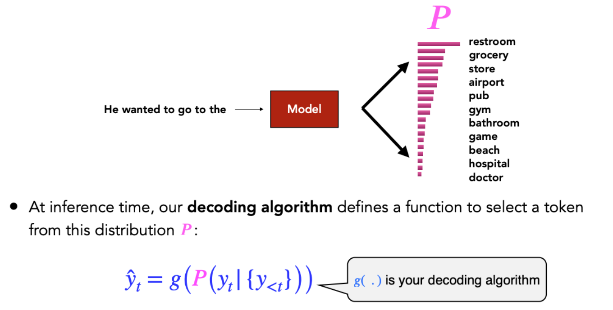
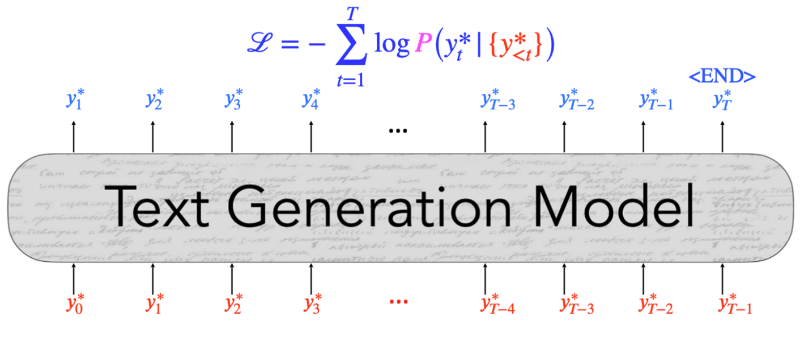
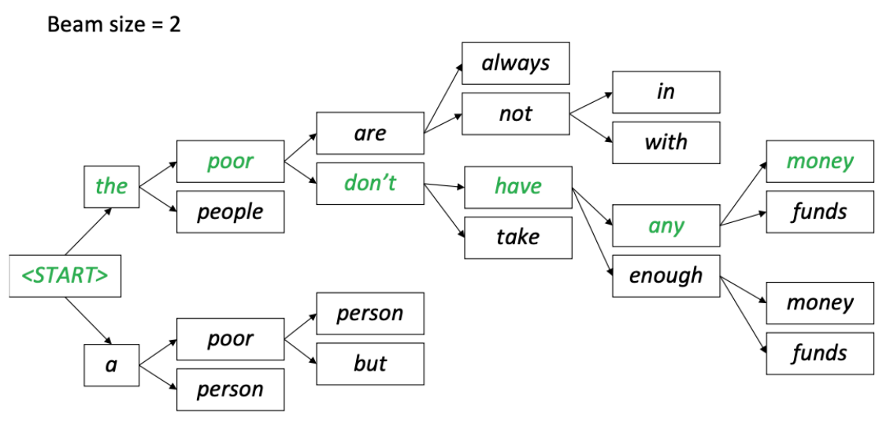
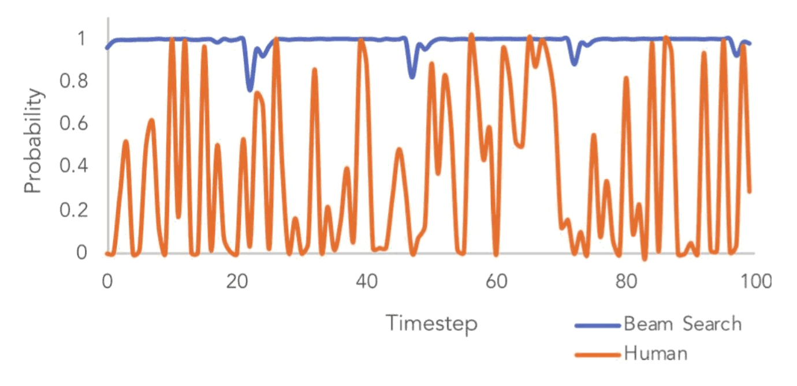
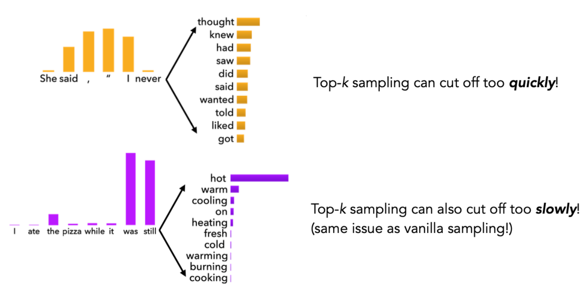
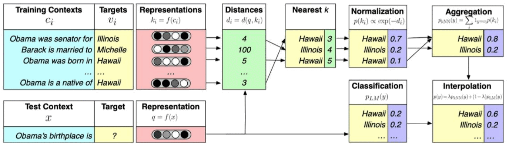

# Lecture 8 — Natural Language Generation

> How do language models actually produce text? This lecture covers the generation loop, the decoding algorithms that turn a probability distribution into words (greedy, beam search, sampling, top-k, top-p, temperature), and the problems with training by teacher forcing, plus how reinforcement learning can help.

**After this lecture you should be able to:**
- Describe one step of autoregressive generation: scores, softmax, decoding algorithm.
- Write down the teacher-forcing (maximum likelihood) loss and explain what the "gold" token is.
- Run beam search by hand on a small example and explain why greedy methods become repetitive.
- Compare argmax, beam search, pure sampling, top-k, top-p and temperature, and say when each fails.
- Explain the two training issues, MLE discouraging diversity and exposure bias, and how to address them.
- Write the REINFORCE loss with a baseline and explain reward hacking.

---

## 1. What is natural language generation?

**Natural language generation (NLG)** is the subfield of NLP that builds systems that automatically produce **coherent** and **useful** written or spoken text for people to read or hear. In short: *any task that produces text for human consumption needs NLG.*

Classic NLG tasks: **machine translation**; **summarization** (documents, e-mails, meetings); **data-to-text** (e.g., a sports-statistics table turned into a game report); **visual description** (image captions and paragraphs); and **creative generation** (outline-conditioned stories, poetry).

Like T5 and BART, you can cast almost any of these as **sequence-to-sequence**. Today one chat model (ChatGPT) does all of them: travel plans, code, course curricula. **LLM agents** go further. They plan, ask clarifying questions and carry out multi-step tasks.

The question for this lecture: *how do we make deep learning models generate natural language?*

## 2. Basics of NLG

Most text generators are **autoregressive**: they predict the **next token** from the **past tokens**. At each time step $t$, the model takes the tokens so far, $\{y\}_{<t}$, and outputs a new token $\hat{y}_t$. That token is then fed back in as input to predict $\hat{y}_{t+1}$, and so on.

### A look at a single step
1. The model $f$ with parameters $\theta$ computes a **score** for every token in the vocabulary, $S \in \mathbb{R}^{V}$:
$$S = f(\{y_{<t}\}, \theta)$$
2. A **softmax** turns the scores into a probability distribution $P$ over $w \in V$:
$$P(y_t = w \mid \{y_{<t}\}) = \frac{\exp(S_w)}{\sum_{w' \in V} \exp(S_{w'})}$$
3. At inference time, a **decoding algorithm** $g$ selects a token from this distribution:
$$\hat{y}_t = g\big(P(y_t \mid \{y_{<t}\})\big)$$

Running example: given *"He wanted to go to the"*, the model puts most probability on *restroom*, then *grocery*, *store*, *airport*, *pub*, ... with a long tail ending in *hospital*, *doctor*.

  

<em>One generation step: the model only produces a distribution P; the decoding algorithm g decides which token is actually emitted.</em>

## 3. Training: maximum likelihood (teacher forcing)

We train the model to minimize the **negative log-likelihood** of the next token in a training sequence:
$$\mathcal{L}_t = -\log P(y_t^{\ast} \mid \{y^{\ast}_{<t}\})$$

- This is a **multi-class classification** task: each word $w \in V$ is a class.
- The label at each step is the actual word $y_t^{\ast}$ in the training text, called the **gold** or **ground-truth** token.
- Sum over the whole sequence (up to the `<END>` token):
$$\mathcal{L} = -\sum_{t=1}^{T} \log P(y_t^{\ast} \mid \{y^{\ast}_{<t}\})$$

This is **teacher forcing**: during training, the inputs at each step are always the *gold* previous tokens $y^{\ast}_{<t}$, never the model's own predictions.

  

<em>Teacher forcing: every input is a gold token, shifted by one position from the gold target the model must predict.</em>

So: **training** fits a calibrated next-token distribution with MLE. **Inference** uses a decoding algorithm $g$ to pick tokens from that distribution, feeding back its *own* outputs $\hat{y}_{<t}$.

## 4. Decoding: greedy methods

### Argmax (greedy) decoding
Pick the highest-probability token at every step:
$$\hat{y}_t = \arg\max_{w \in V} P(y_t = w \mid \{y\}_{<t})$$
For *"He wanted to go to the"*, that is always *restroom*.

**Problem:** you **cannot revise earlier decisions**. Translating *les pauvres sont démunis* (*the poor don't have any money*), greedy might produce *the poor **are** ...* and get stuck with it.

### Beam search
**Explore several hypotheses instead of one.** Keep the $b$ most probable partial sequences at each step. $b$ is the **beam size**. Each hypothesis is scored by its **cumulative log-probability** (a sum of log-probs, so always $\le 0$; higher is better).

Worked example with $b = 2$:

| Step | Candidates (score) | Kept |
|---|---|---|
| 1 | *the* (−1.05), *a* (−1.39) | both |
| 2 | *the poor* (−1.90), *the people* (−2.3), *a poor* (−1.54), *a person* (−3.2) | *a poor*, *the poor* |
| 3 | *the poor are* (−2.42), *the poor don't* (−2.13), *a poor person* (−3.12), *a poor but* (−3.53) | *the poor don't*, *the poor are* |
| 4 | *...are always* (−3.82), *...are not* (−2.67), *...don't have* (−3.32), *...don't take* (−3.61) | *are not*, *don't have* |

Continue until the end. The best final hypothesis is *the poor don't have any money*. Note that *a poor* led at step 2 but dropped out later. Beam search can recover from a choice that looked good early.

  

<em>The full beam-search tree for this example; the green path is the best final hypothesis, and the "a poor ..." branch is pruned.</em>

## 5. The problem with likelihood-maximizing decoding

Greedy and beam search **work well for MT and summarization**, where the output closely matches the input. They do **not** work well for open-ended tasks (stories, dialogue) where there is no strong input–output correspondence.

Why? They **maximize the likelihood of the sequence**, and maximum-likelihood sequences are **repetitive**:
- **Step-by-step NLL plots:** for *"I don't know. I don't know. ..."*, the negative log-likelihood of each repetition **decreases over time**: each repeat makes the next one *more* likely. **The longer it goes, the worse it gets**, and it is **worse for Transformer LMs** than for LSTMs.
- In the unicorn story example, the model loops *"Universidad Nacional Autónoma de México/"* forever.

**Repetition is a big problem in text generation.** Also, beam-search text sits near probability 1 at every step, while human text jumps around a lot. **Human language is not well approximated by probability maximization.**

  

<em>Per-token probability: beam search stays pinned near 1, while human-written text is often surprising.</em>

## 6. Decoding: sampling methods

### Random (vanilla) sampling
Sample from the full distribution:
$$\hat{y}_t \sim P(y_t = w \mid \{y\}_{<t})$$
It is random, so any token can appear (e.g., *bathroom* instead of *restroom*).

**Problem:** every token in the vocabulary is an option. Even if most probability mass is on a few tokens, the **tail can be very long**. Many tail tokens are irrelevant. Each one has a tiny chance, but *as a group* they have a high chance of being picked.

### Top-k sampling
Sample only from the **top $k$** tokens (renormalized). Common values are $k = 5, 10, 20$, but it's up to you.
Increase $k$ for more **diverse/risky** outputs; decrease it for more **generic/safe** ones.

**Problem:** distributions are dynamic, but $k$ is fixed.
- **Flat distribution** (*"She said, 'I never ___'"*: thought, knew, had, saw, ...): a small $k$ **cuts off too quickly** and removes many valid options.
- **Peaked distribution** (*"I ate the pizza while it was still ___"*: almost all mass on *hot*): a large $k$ **cuts off too slowly** and lets unlikely tokens in. That is the same issue as vanilla sampling.

  

<em>The same fixed k is too small for the flat distribution (top) and too large for the peaked one (bottom).</em>

### Top-p (nucleus) sampling
Sample from all tokens in the **top $p$ cumulative probability mass**, i.e., where the mass is concentrated. The number of tokens kept **varies with how uniform $P_t$ is**: many tokens for a flat distribution, few for a peaked one.

### Softmax temperature
Divide the scores by a **temperature** $\tau$ before the softmax:
$$P_t(y_t = w) = \frac{\exp(S_w / \tau)}{\sum_{w' \in V} \exp(S_{w'} / \tau)}$$
- **Raise** $\tau > 1$: $P_t$ becomes more **uniform**. Output is **more diverse** (mass is spread across the vocabulary).
- **Lower** $\tau < 1$: $P_t$ becomes more **spiky**. Output is **less diverse** (mass is concentrated on top words).
- $\tau \to 0$: all mass moves to the highest-probability token, which gives **greedy decoding**.

| Method | How it picks the next token | Strength | Weakness |
|---|---|---|---|
| Argmax (greedy) | Highest-probability token | Simple, fast | Can't revise choices; repetitive |
| Beam search | Keeps $b$ best partial sequences by log-prob | Better sequence likelihood; good for MT/summarization | Still maximizes likelihood: repetitive, bland in open-ended tasks |
| Pure sampling | Sample from full $P$ | Diverse | Long tail of irrelevant tokens |
| Top-k | Sample from top $k$ tokens | Cuts the tail | Fixed $k$: too small for flat $P$, too large for peaked $P$ |
| Top-p (nucleus) | Sample from smallest set covering mass $p$ | Adapts to the shape of $P$ | You still choose $p$ |
| Temperature $\tau$ | Rescales scores before softmax | Tunes diversity | High $\tau$ spreads mass over the whole vocabulary; $\tau \to 0$ gives greedy |

## 7. Improving decoding

### Re-balancing distributions
What if you don't trust how well your model's distribution is calibrated? **Don't rely only on the model's distribution.**

Solution: re-balance $P_t$ using **retrieval from n-gram phrase statistics** (as in kNN-LM):
- Cache a database of phrases from your training corpus (or another corpus).
- At decoding time, find the most similar phrases in the database.
- Build the induced distribution $P_{\text{phrase}}$ over the words that follow them, and interpolate it with the model's:
$$P(y) = \lambda\, P_{\text{phrase}}(y) + (1 - \lambda)\, P_{LM}(y)$$

In class: for *"Obama's birthplace is ___"*, the nearest stored contexts point to *Hawaii*, pushing the final distribution toward *Hawaii*.

  

<em>Retrieval re-balancing: the nearest stored contexts vote for Hawaii, and interpolation lifts it from 0.2 to 0.6.</em>

### Re-ranking
What if you decode a bad sequence? **Decode several sequences** (10 candidates is common), score each with an approximation of quality, and **re-rank**.
- Simplest score: **perplexity**. Careful: repetitive sequences can get low perplexity.
- Re-rankers can score many properties: style, discourse, entailment/factuality, logical consistency, and more. You can use several in parallel.
- Beware of **poorly calibrated re-rankers**.

**Decoding wrap-up:** decoding is still a hard problem. Different decoders add different biases to the text, and some of the most impactful recent advances in NLG are **simple but effective changes to decoding**.

**"Why do we need fancy decoders? Shouldn't our models just be better calibrated?"** That question leads into training. Part of the problem comes from *how* we train.

## 8. Training issues

### Issue #1: MLE discourages diversity
Teacher forcing trains the model to put high probability on the observed text. The result is the same repetitive, low-diversity output seen above (the unicorn loop, *"I'm tired."* forever).

How can we increase the diversity of sequences seen during training?
- **More data. Pretraining.**
- **Learn from the sequences the model generates itself.**

### Issue #2: Exposure bias
Training with teacher forcing leads to **exposure bias** at generation time:
- During **training**, inputs are gold tokens from real, human-written text:
$$\mathcal{L}_{MLE} = -\log P(y_t^{\ast} \mid \{y^{\ast}_{<t}\})$$
- During **generation**, inputs are the model's own previously decoded tokens:
$$\mathcal{L}_{dec} = -\log P(\hat{y}_t \mid \{\hat{y}_{<t}\})$$

The model never saw its own mistakes in training, so one bad token can lead it into unfamiliar contexts where it **loses coherence**. Models must learn to **recover from their own bad samples**, e.g. with **scheduled sampling** or **reinforcement learning**. (This is also a shortcoming of SFT alone, besides data being expensive to collect.)

## 9. Reinforcement learning for NLG

Cast the text generator as a **Markov decision process**:
- **State** $s$: the model's representation of the preceding context.
- **Actions** $a$: the words that can be generated.
- **Policy** $\pi$: the decoder.
- **Rewards** $r$: given by an external score.

Learn behaviours by rewarding the model when it shows them.

### REINFORCE
Sample a sequence $\hat{Y}$ from your model, then minimize:
$$\mathcal{L}_{RL} = -R(\hat{Y}) \sum_{t=1}^{T} \log P(\hat{y}_t \mid \{x^{\ast}\}; \{\hat{y}\}_{<t})$$
- The $\log P$ term: *next time, increase the probability of this sampled token in the same context*, and the reward: *do it more if the reward was high*.
- Usually one aggregate reward is used for the whole sequence, so every token gets the same reward.
- For instruction following: given an **instruction** $x^{\ast}$, sample a **demonstration** from the model and reward it.

### Reward estimation
- **Use your evaluation metric**: BLEU (MT), ROUGE (summarization), CIDEr and SPIDEr (image captioning).
- Be careful to **optimize for the task, not "game" the reward**. Metrics are only proxies. RL refinement can improve BLEU while barely improving how humans rate the translation.
- You can also reward behaviours such as simplicity, politeness, sentiment or formality.
- If you can formalize a behaviour as a reward function, **or train a neural network to approximate it**, you can train a generator to show that behaviour. This is the **reward model** from RLHF:
$$\mathcal{L}_{RM} = -\log \sigma\big(R(Y_+) - R(Y_-)\big)$$

### Implementation tricks
- **Start from a model pretrained with SFT.**
- **Use a baseline** $b$:
$$\mathcal{L}_{RL} = -\big(R(\hat{Y}) - b\big) \sum_{t=1}^{T} \log P(\hat{y}_t \mid \{x^{\ast}\}; \{\hat{y}\}_{<t})$$
  Why? If $R(\hat{Y}) > 0$ always, you **never penalize a generation**. You only reinforce some more than others. Subtracting $b$ pushes samples that score below the baseline *down*.
- **Keep encouraging coherence** by mixing in the MLE loss:
$$\mathcal{L} = \mathcal{L}_{MLE} + \alpha\, \mathcal{L}_{RL}$$

### Reward hacking
*Can I use a "politeness classifier" as a reward function?* Yes: reward sequences the classifier calls polite. But the model **learns to add "please" 20× to the end of every utterance**. It maximizes the reward, not the behaviour you wanted.

**Training wrap-up:** teacher forcing is still the main training algorithm, despite its diversity and exposure-bias problems. RL can teach behaviours that are hard to formalize, but learning can be very **unstable**.

RLHF with PPO and DPO is covered in Lecture 7.

---

## Key takeaways
- Autoregressive generation: scores $S = f(\{y_{<t}\}, \theta)$, softmax to $P$, decoding algorithm $g$ picks $\hat{y}_t$, then repeat.
- Training uses teacher forcing: minimize $-\sum_t \log P(y_t^{\ast} \mid \{y^{\ast}_{<t}\})$ with gold inputs.
- Greedy and beam search maximize likelihood. They are good for MT and summarization but repetitive for open-ended generation.
- Repetition reinforces itself: each repeat makes the next more likely, especially for Transformers.
- Sampling adds diversity. Top-k cuts the long tail with a fixed $k$, and top-p adapts to the shape of the distribution.
- Temperature $\tau$ flattens ($\tau>1$) or sharpens ($\tau<1$) the distribution. $\tau \to 0$ is greedy.
- MLE discourages diversity, and exposure bias comes from training on gold inputs but generating from your own.
- REINFORCE optimizes a reward on sampled outputs. Use a baseline and mix in MLE, and watch out for reward hacking.

## Check yourself

What is an inherent problem with argmax decoding?

It cannot revise earlier decisions. Once it picks a token (e.g., *the poor **are***), it is stuck with it, even if a better sequence started with a less likely token.

What is an inherent problem with greedy decoding (including beam search)?

It works well for MT or summarization but not for tasks without a strong input–output correspondence. It maximizes sequence likelihood, and maximum-likelihood sequences are repetitive. Each repetition makes the next one more likely.

What's a potential problem with top-k sampling?

$k$ is fixed, but distributions change. For a flat distribution a small $k$ cuts off too quickly (removes valid options). For a peaked one a large $k$ cuts off too slowly (lets in unlikely tokens). Top-p fixes this by adapting the number of tokens.

What happens if the temperature goes to 0?

All probability mass moves to the highest-scoring token, so sampling becomes greedy (argmax) decoding.

What is exposure bias?

With teacher forcing the model always sees gold previous tokens during training, but at generation time it sees its own (possibly wrong) previous tokens. It never learned to recover from its own mistakes, so it loses coherence. Fixes: scheduled sampling, RL.

Why use a baseline $b$ in REINFORCE?

If rewards are always positive, every sampled generation gets reinforced and none is ever penalized. Using $R(\hat{Y}) - b$ pushes below-baseline samples down and above-baseline samples up.

---
📚 Want to go deeper? See the **Lecture 8** section of [Further Reading](Further-Reading.md#8--natural-language-generation).
