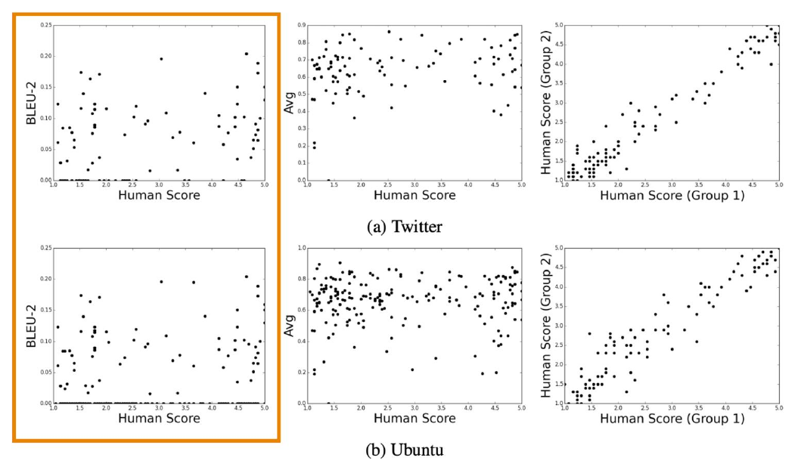
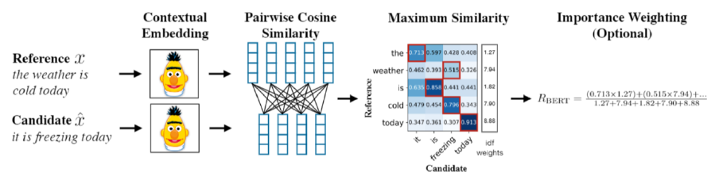
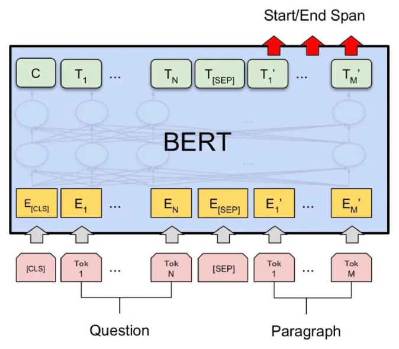
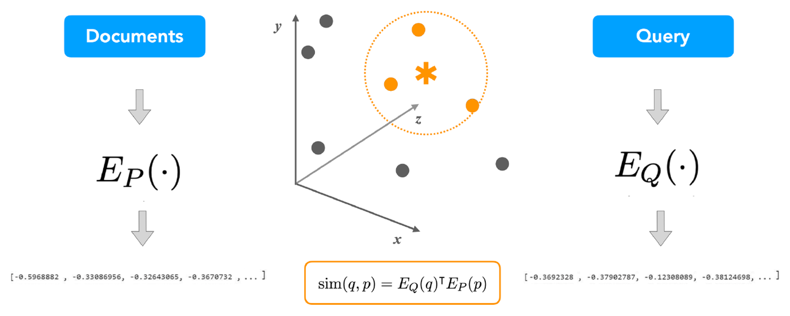
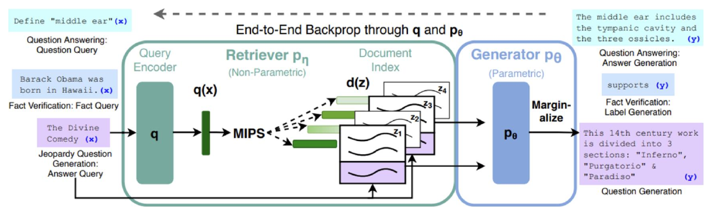
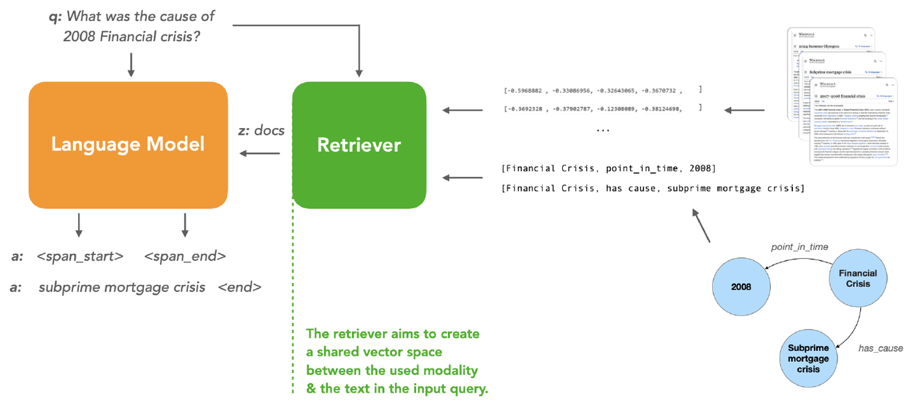

# Lecture 9 — Evaluating Generation, Question Answering and RAG

> How do you know whether generated text is any good? This lecture covers the main ways to evaluate NLG systems, then applies them to question answering (QA), and finally shows how retrieval-augmented language models fix some core limitations of LLMs (stale knowledge, hallucination, no sources).

**After this lecture you should be able to:**
- Explain why perplexity, n-gram overlap metrics and even human ratings each fall short as measures of generation quality
- Compare content-overlap, model-based and human evaluation (what they compare, strengths, weaknesses)
- Describe extractive QA as start/end span prediction with BERT, and contrast it with generative QA
- Compute Exact Match and F1 for a QA prediction and explain where they break down
- Explain how dense passage retrieval (DPR) works and how it is trained
- Describe a retrieval-augmented LM ($`p(y \mid x)`$ with retriever and LM) and place RAG, REALM, ERNIE and Toolformer in the landscape

---

## 1. Why evaluation is hard: gaming the reward

When training with RL (Lecture 8), the obvious reward is your **evaluation metric**: BLEU (translation), ROUGE (summarization), CIDEr/SPIDEr (captioning). But metrics are only **proxies** for quality. Optimize them directly and the model can **"game" the reward** instead of solving the task: "even though RL refinement can achieve better BLEU scores, it barely improves the human impression of the translation quality" (Wu et al., 2016).

## 2. Perplexity: a first try

Idea: evaluate the model by its **perplexity on reference (human-written) sentences**.

Why not use perplexity of the model's **own generations**? Decoding algorithms that minimize perplexity (argmax, beam search) would be advantaged even when their text is bad. Case in point: the unicorn-story continuation that repeats "Universidad Nacional Autónoma de México/..." over and over is the kind of likely-but-bad text such decoding produces.

Perplexity on references tells you how **calibrated** the model is to real sequences, but not much about the generations it produces.

## 3. How NLG evaluation differs from classification

Classification has one correct label. In generation, **any "right" answer you know could be one of many.** Asked *"Are you going to Prof. Arora's NLP lecture?"*, the human reference is *"Heck yes!"*, but *"Yes!"*, *"You know it!"* and *"Yup."* are all valid.

Three families of evaluation: **content overlap metrics**, **model-based metrics** and **human evaluations**.

## 4. Content overlap metrics

These compute a score for the similarity between the **generated** text and **gold-standard (human-written)** text. Running example:

- Ref: *They walked to the grocery store .*
- Gen: *The woman went to the hardware store .*

They are **fast, efficient and widely used**. Two broad categories:
- **N-gram overlap metrics**: BLEU, ROUGE, METEOR, CIDEr, etc.
- **Semantic overlap metrics**: PYRAMID, SPICE, SPIDEr, etc.

### N-gram overlap metrics
They count shared words/n-grams between generation and reference (BLEU is precision-oriented, ROUGE recall-oriented). A metric is judged by its **correlation with human judgments**. For machine translation, n-gram metrics are not ideal but do correlate with humans.

**Failure case.** Reference: *"Heck yes!"*. Scores of candidate replies:

| Candidate | Score | Problem |
|---|---|---|
| Yes ! | 0.61 | |
| You know it ! | 0.25 | |
| Yup . | 0 | **False negative**: valid answer, zero score |
| Heck no ! | 0.67 | **False positive**: opposite meaning, highest score |

N-gram overlap metrics have **no concept of semantic relatedness**. On dialogue data (Twitter, Ubuntu), BLEU-2 barely correlates with human scores, while two groups of humans agree well.

<p align="center">
  
</p>
<p align="center"><em>BLEU-2 (boxed, left) is scattered with no trend against human scores, while two halves of human raters (right) line up along the diagonal.</em></p>

They get progressively **worse for more open-ended tasks**: worse for **summarization** (longer outputs), much worse for **dialogue**, much, much worse for **story generation** (where long sequences can make scores look decent).

### Semantic overlap metrics
- **PYRAMID** (summarization): compares **Summarization Content Units (SCUs)**, accounting for human variation in content selection.
- **SPICE** (captioning): parses the reference into an abstract **scene graph** and compares propositions.
- **SPIDEr**: combines SPICE (semantic graph) and CIDEr (n-gram) similarity.

## 5. Model-based metrics

Use **learned representations** (embeddings) to compute semantic similarity between generated and reference text. No more **n-gram bottleneck**. The embeddings are pretrained; the distance function is fixed.

- **Vector similarity**: embedding-based similarity (Embedding Average, Vector Extrema, MEANT, YISI).
- **Word Mover's Distance**: distance between two sequences via word-embedding matching.
- **BERTScore**: matches candidate and reference words by cosine similarity of BERT's **contextual** embeddings (max similarity per token, optional importance weighting).

<p align="center">
  
</p>
<p align="center"><em>BERTScore credits "freezing" for matching "cold" because their contextual embeddings are similar, even though the words differ.</em></p>
- **Sentence Movers Similarity**: WMD over sentence embeddings.
- **BLEURT**: a BERT-based regression model scoring how grammatical the candidate is and how well it conveys the reference's meaning.
- **LLMs as judges**: prompt an LLM with a clear **rubric** (G-Eval, LLM-as-a-judge: pairwise comparison or a 1–10 rating).

The benefit over overlap metrics: they capture **meaning**, not surface form, and correlate better with human judgment.

## 6. Human evaluation

Human evaluation is the **most important** form of evaluation for generation (>75% of generation papers at ACL 2019 used it) and the **gold standard**: new automatic metrics must correlate with it. Humans rate quality overall or along dimensions: **fluency, coherence/consistency, factuality and correctness, commonsense, style/formality, grammaticality, typicality, redundancy**. Never compare human scores across differently-conducted studies, even for the "same" dimensions.

**Case study.** 200 human-written and 200 GPT-2 stories (~150 words, same prompts) were rated 1–5 on Amazon Mechanical Turk for grammar, coherence, likability and relevance. Workers **failed to distinguish** human from GPT-2 stories, agreed poorly with each other, and spent a median of **13 seconds** per task. English teachers needed 10–20 examples to calibrate, found GPT-2 stories harder to rate, and suggested a rubric.

**Issues:** human evaluation is **slow and expensive**, and hard to do well. Humans are **inconsistent**, can be illogical, lose concentration, misinterpret your question, can't always explain their ratings, and may rush.

## 7. Evaluation takeaways

| Family | Compares | Pros | Cons |
|---|---|---|---|
| Content overlap | Words/n-grams (or semantic units) vs reference | Fast, cheap, widely used | No notion of meaning; poor for open-ended tasks |
| Model-based | Embeddings / learned scores vs reference | Better correlation with humans | Not interpretable |
| Human | Human judgment on chosen dimensions | Gold standard; can judge **factuality** | Slow, expensive, inconsistent |

Often the best judge of output quality is **you**: look at your model's generations, don't just rely on numbers ("vibes-based evaluation").

---

## 8. Question answering

**Goal:** systems that automatically answer questions posed by humans in natural language (chatbots, search engines, forums). A QA model takes a **context** and a **question** ("Which name is also used to describe the Amazon rainforest in English?") and outputs an **answer** ("Amazonia").

**Classical QA** converted text into **logical forms** (e.g., a CCG parse) and executed them against structured databases (Freebase). *Challenge:* open-domain data and relationships outside the database.

**QA varies by** source (passages, KBs, tables, images), question type (factoid vs commonsense, open- vs closed-domain, simple vs multi-hop) and answer type (snippet, paragraph, yes/no, numerical). The two main types are **extractive** (answer extracted from the context) and **generative** (answer generated auto-regressively).

### Extractive QA
**Goal:** predict the **start** and **end** tokens of the answer in the context. Input: `<question> [SEP] <context>` into BERT. Add **two linear layers** on top, one for start and one for end (separate weights, trained together). Dot each token's output embedding with the start weights, softmax over all tokens, and pick the most probable token as start; same for end.

<p align="center">
  
</p>
<p align="center"><em>Question and paragraph go in together; start and end positions are predicted only over the paragraph's output tokens.</em></p>

**SQuAD:** "When were the Normans in Normandy?" → span "10th and 11th centuries" in a passage about the Normans. ~130K train, 12K test, 50K unanswerable questions. It requires cross-sentence reasoning, handling paraphrases, and world knowledge.

**Why so popular?** Closed-form task (just highlight spans), SQuAD was **big** (>100K questions) when deep learning took off, and progress over classical methods was easy. Leaderboards **saturated**: top models beat human EM/F1.

**Is reading comprehension solved? No.** Add a distractor sentence ("Quarterback Jeff Dean had jersey number 37 in Champ Bowl XXXIV") and the answer flips from John Elway to Jeff Dean. Systems perform **much worse on adversarial samples**.

### Generative QA
Extractive QA forces the answer to occur in the context. Generative models output it **one token at a time**:

```math
P(\mathbf{a} \mid \mathbf{c}, \mathbf{q}; \theta) = \prod_{i=1}^{|\mathbf{a}|} P(a_i \mid \mathbf{c}, \mathbf{q}, \mathbf{a}_{\lt i}; \theta)
```

This works **open-book** (with context) or **closed-book** (without), with autoregressive LMs (GPT) or seq2seq models (T5, BART) fine-tuned on QA examples.

| | Extractive | Generative |
|---|---|---|
| Pros | Syntactic and lexical consistency; factual accuracy | Human-like responses; suited to long-form answers and cross-sentence reasoning |
| Cons | Can't produce novel utterances; rigid output (truncated sentences) | Hallucinations, lexical repetitions; grammar mistakes |

The right choice depends on the user's requirements and the application.

### Evaluating QA
Example: "Who is the president of France?", gold answer "Emmanuel Macron".
- **Exact Match (EM):** percentage of predictions matching any gold answer exactly (`1 if str(gold) == str(pred) else 0`). "Emmanuel Jean-Michel Frédéric Macron" gets EM = 0.
- **F1:** average **token overlap** between prediction and gold answer. More forgiving: the long name gets credit.
- Complementary approaches: compute EM/F1 over the **top-k** answers; **post-process** outputs (lemmatize, remove stop words) before scoring.

Challenge: **semantic answer similarity**. "100%" and "One hundred percent" are equivalent but share no tokens. For **long-form QA** (e.g., Natural Questions), the challenges are **the same as for NLG evaluation**: qualitative measures (topical, fluent, coherent, commonsense) plus content-overlap (ROUGE, BLEU) and model-based (BERTScore) metrics.

### QA in the LLM era
**Customize the prompt** with few-shot exemplars to get different output structures from the same context: a list of causes (information retrieval), a cause | effect table (graph extraction), or "Yes/No because ..." (chain of thought).

---

## 9. Retrieval-augmented language models

### Why retrieval?
Ask ChatGPT "Who won the first round of presidential elections in Turkey last Sunday?" and it says its training only goes until September 2021: a **factuality** and **temporality** problem. Can we update a model's knowledge without updating its parameters?

**Limitations of PLMs/LLMs:** **hallucination** (factual errors); **long-tail** knowledge poorly covered in pretraining; **static** knowledge that is hard to update; **non-attributable** information (where did it come from?). These matter for factual-heavy tasks like fact verification (FEVER) and factual QA.

**Retrieval helps:** precise knowledge access, easy updates, more attributable output. Limitations: needs supervision or heuristics, and task-specific integration.

### Finding the answer in 21M documents
For "Where the financial crisis of 2008 started?", you could concatenate all documents into one long input, but long context is still a work in progress beyond simple look-up. Instead, first **retrieve** documents that might contain the answer, then read them.

### Dense Passage Retrieval (DPR)
Encode documents and query into one vector space and retrieve the top-$`k`$ documents. Passage encoder $`E_P(\cdot)`$, query encoder $`E_Q(\cdot)`$, dot-product similarity:

```math
\text{sim}(q, p) = E_Q(q)^\top E_P(p)
```

<p align="center">
  
</p>
<p align="center"><em>Two separate encoders map passages and the query into the same space; the passages closest to the query (orange) are retrieved.</em></p>

**Training** goal: relevant question–passage pairs should be closer than irrelevant ones. For question $`q_i`$ with one positive passage $`p_i^+`$ and $`n`$ negatives $`p_{i,j}^-`$:

```math
L(q_i, p_i^+, p_{i,1}^-, \dots, p_{i,n}^-) = -\log \frac{e^{\text{sim}(q_i, p_i^+)}}{e^{\text{sim}(q_i, p_i^+)} + \sum_{j=1}^{n} e^{\text{sim}(q_i, p_{i,j}^-)}}
```

### The retrieval-augmented LM
A **retriever** $`p(z \mid x)`$ picks documents $`z`$ for input $`x`$ ($`z`$ is often a latent variable), and the **LM** produces the answer given the query and retrieved documents:

```math
p(y \mid x) = \sum_{z \in Z} p(z \mid x)\, p(y \mid z, x), \qquad p(y \mid z, x) = \prod_{i}^{N} p(y_i \mid x, z, y_{1:i-1})
```

**Terminology:** *memory* = knowledge stored in parameters. The LM's memory is **implicit/parametric**; the retriever's is **explicit/non-parametric**. *Modalities* = the type of external source: knowledge bases, knowledge graphs, tools.

**The landscape** has three axes:
- **Architecture of the LM:** generative vs extractive → e.g., **RAG** (fine-tuning + KB).
- **Training of the components:** pre-training vs fine-tuning → e.g., **REALM** (pre-training + KB).
- **Type of external knowledge:** documents, knowledge graphs, tools → e.g., **ERNIE** (pre-training + KG), **Toolformer** (fine-tuning + tools).

**Generative vs extractive:** for "What's the angle of an equilateral triangle?", a generator (auto-regressive) writes "60 degrees <end>"; an encoder (auto-encoder) predicts `<span_start>`/`<span_end>` in the retrieved docs.

**RAG** = pre-trained generator (BART) + pre-trained retriever (DPR) + indexed KB (Wikipedia). It retrieves top documents by maximum inner product search (MIPS), marginalizes over them, and trains end-to-end through the query encoder and generator.

<p align="center">
  
</p>
<p align="center"><em>The same retriever + generator handles QA, fact verification and question generation; gradients flow back into the query encoder but not the document index.</em></p>

**REALM** pre-trains end-to-end on masked text: **first retrieve** useful documents, **then predict** the masked token from query plus document (minimize perplexity). Benefits: transfer across tasks, learning what helps beyond lexical overlap, unsupervised alignment between text and knowledge corpus.

**Other knowledge types:** the retriever builds a shared vector space between the modality (e.g., KG triples like [Financial Crisis, has cause, subprime mortgage crisis]) and the query text.

<p align="center">
  
</p>
<p align="center"><em>The retriever can draw on documents or knowledge-graph triples alike, as long as they share a vector space with the query.</em></p>

**ERNIE** extracts entity mentions, aligns them to KG entities, and fuses their pre-trained entity embeddings into the encoder.

**Augmented LLMs (agents)** call tools and APIs: **ReAct** interleaves search actions with reasoning; **Toolformer** inserts calls such as a calculator or Wikipedia search.

**Additional benefits:** **modularity** (swap knowledge at test time), **attribution** (trace answers to documents), **parameter efficiency** (RETRO, 7B parameters, 1/25 the size of GPT-3).

| | Closed-book | Retrieval |
|---|---|---|
| Knowledge | In parameters (static) | External, updatable |
| Size | Largest models ~$`O(10^{11})`$ params | Often ~$`O(10^9)`$ params |

All leading open-domain QA models use retrieval, and they are much more efficient than the largest LLMs. In the LLM era, retrieval augments the prompt, and models increasingly interact with tools and APIs.

---

## Key takeaways
- Metrics are proxies; optimizing them directly can game the reward.
- Perplexity on references measures calibration, not generation quality.
- N-gram metrics ignore meaning ("Heck no!" beats "Yup.") and degrade on open-ended tasks.
- Model-based metrics track humans better but aren't interpretable; humans are the gold standard but slow and inconsistent.
- Extractive QA predicts start/end spans; generative QA writes answers token by token.
- EM is strict, F1 counts token overlap; long-form QA inherits NLG evaluation problems.
- Retrieval tackles hallucination, static knowledge and attribution; DPR uses two encoders and a contrastive loss.

## Check yourself
<details>
<summary>Why would optimizing for the evaluation metric "game" the reward? Shouldn't the metric measure what we want?</summary>

Metrics are only proxies. A model optimized on BLEU learns to exploit what BLEU counts rather than write better text: RL raised BLEU but barely improved human impressions.
</details>

<details>
<summary>Why can't you evaluate a generator by the perplexity of its own outputs?</summary>

Decoding methods that minimize perplexity (argmax, beam search) would win even when their text is bad, e.g., highly repetitive. Perplexity on references only tells you how calibrated the model is.
</details>

<details>
<summary>The reference reply is "Heck yes!". Why do "Yup." (score 0) and "Heck no!" (score 0.67) show the weakness of n-gram metrics?</summary>

"Yup." is a valid answer with zero overlap (false negative). "Heck no!" means the opposite but shares many tokens (false positive). N-gram metrics have no concept of semantic relatedness.
</details>

<details>
<summary>What might be a benefit of model-based metrics compared to overlap metrics?</summary>

They compare embeddings, so they capture semantic similarity (synonyms, paraphrases) instead of exact surface matches, and they correlate better with human judgment. Their downside is that they're not interpretable.
</details>

<details>
<summary>Gold: "Emmanuel Macron". Prediction: "Emmanuel Jean-Michel Frédéric Macron". What are EM and F1 like?</summary>

EM = 0, because the strings differ. F1 is positive, because the tokens "Emmanuel" and "Macron" overlap. F1 is more forgiving than EM.
</details>

<details>
<summary>How is DPR trained, and how does it score a passage at test time?</summary>

Score = $`E_Q(q)^\top E_P(p)`$. Training uses a negative log-likelihood loss that pushes the positive passage's similarity above the negatives'.
</details>

---
📚 Want to go deeper? See the **Lecture 9** section of [Further Reading](Further-Reading.md#9--evaluating-generation-question-answering-and-rag).
